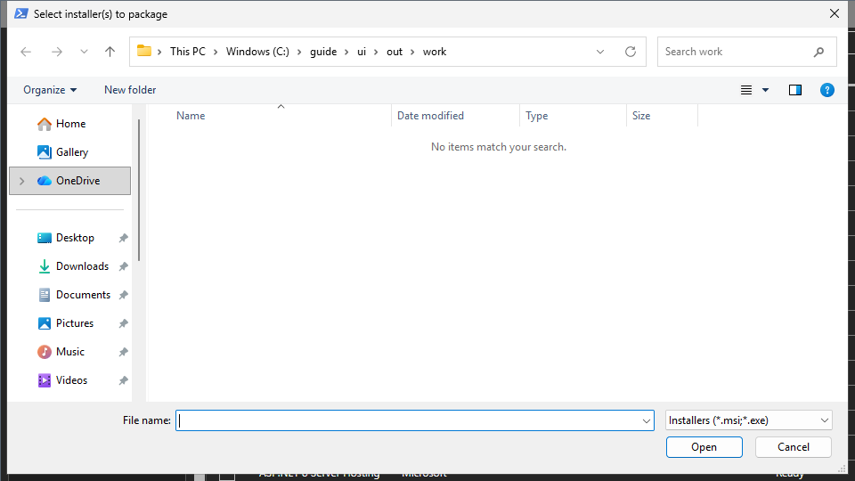

# Add Installer

Add Installer packages an `.msi` or `.exe` file that has no packager. You drop the file on the window or pick it.

## What it does

The tool analyzes the installer: the engine, the MSI property tables and the silent switches. It opens a manifest preview that you can edit, then stages or packages the installer through the same manifest pipeline as a packager script. For an NSIS or Inno Setup installer, the tool reads the compiled script, so the uninstall command, the detection key and the install context come from the installer.

## When to use it

Use it for an application that is not in the list of 312, or for a build that you got from someone else.

## Requirements

- An `.msi` or `.exe` installer on this computer.
- For the Package phase: the settings that [Stage and Publish to ConfigMgr](stage-publish.md) lists.

## Steps

1. Select **Add Installer...**. A dialog titled `Select installer(s) to package` opens. You can also drag the file onto the window. A drag from Explorer is blocked when AppPackager and Explorer run at different elevation levels. Use the button in that case.

2. Pick the file and select **Open**. The tool analyzes it and opens the manifest preview.
3. Check the values. For an MSI, the identity is authoritative. For another installer, you must confirm the predicted values before Stage and Package turn on.
4. For an installer that accepts a mode switch, set **Install for**. The install arguments, the uninstall command, the folder, the detection and the context change together.
5. Stage or package the installer.

A dropped installer that you need again can be saved as a starter packager script.

This guide opened the dialog and closed it with **Esc**. It did not analyze or package an installer.

## Options and settings of this page

| Control | Effect |
|---|---|
| **Install for** | Chooses the system or the user mode of an installer that offers both. |
| Manifest preview | Edits the name, the version, the commands and the detection before the build. |

## Limits

- The analysis predicts the silent switches. Only an MSI identity is certain.
- A per-user installer is staged as an **Install for user** deployment type with detection in HKCU.

## Troubleshooting

| Message or symptom | Cause | Fix |
|---|---|---|
| The drop does nothing. | Explorer and AppPackager run at different elevation levels. | Use **Add Installer...**. |
| Stage + Package stays disabled. | The predicted values are not confirmed. | Confirm them in the preview. |

## Links

- [Stage and Publish to ConfigMgr](stage-publish.md)
- [Application Workbench](workbench.md)
