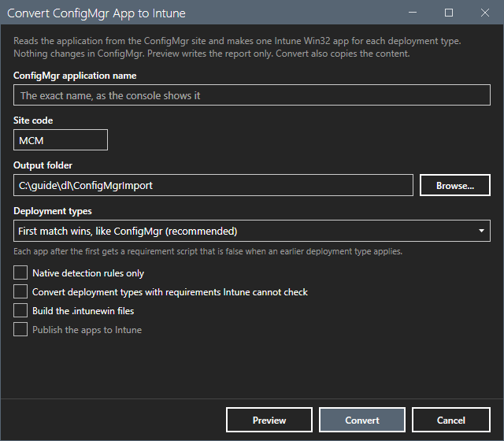
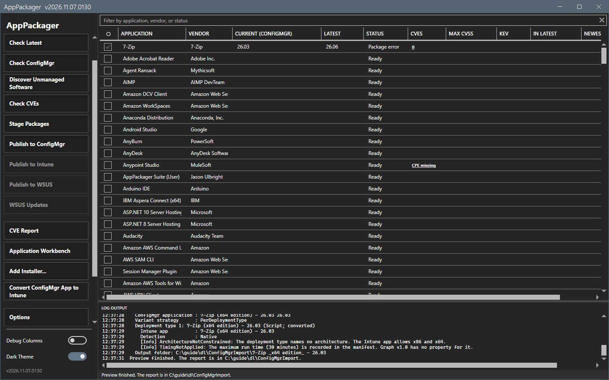

# Convert ConfigMgr App to Intune

This action turns an application that exists in Configuration Manager into Intune Win32 apps.

## What it does

It reads the application from the site, with one Intune app for each deployment type. It only reads the site and never changes the application. **Preview** writes the plan and the report and copies no content. **Convert** also copies the content, and can build the `.intunewin` files and publish the apps.

## When to use it

Use it to move an existing application to Intune, also when AppPackager did not create it.

## Requirements

- The Configuration Manager console on this computer, and read access to the site.
- For publishing: the Intune settings in Options. See [Publish to Intune and Publish to WSUS](publish-intune-wsus.md).

## Steps

1. Select **Convert ConfigMgr App to Intune**. The dialog opens.

2. Type the exact application name, as the console shows it. Check the **Site code** and the **Output folder**.
3. Choose **Deployment types**: `First match wins, like ConfigMgr (recommended)` or another rule. Each app after the first gets a requirement script that is false when an earlier deployment type applies.
4. Set the options: **Native detection rules only**, **Convert deployment types with requirements Intune cannot check**, **Build the .intunewin files**, **Publish the apps to Intune**.
5. Select **Preview**. The log shows each deployment type and its findings. The status bar says `Preview finished. The report is in <folder>.`

6. Select **Convert** to copy the content and build the files. Select **Cancel** to close the dialog.

This guide ran **Preview** for one application of the lab site. It did not run **Convert**, did not build a file and did not publish.

## Options and settings of this page

| Control | Effect |
|---|---|
| Application name | The exact name in the console. |
| Output folder | Where the plan, the report and the content go. |
| Deployment types | How several deployment types are ordered. |
| Native detection rules only | Refuses a deployment type that needs a detection script. |
| Convert deployment types with requirements Intune cannot check | Converts them and names each gap in the report. |
| Build the .intunewin files | Builds the packages. |
| Publish the apps to Intune | Publishes through Microsoft Graph. |

The output folder holds one folder for each deployment type with `Content`, `stage-manifest.json` and `Package\*.intunewin`, and the files `conversion-report.txt` and `relationships.json`.

## Limits

- Windows Installer and script deployment types convert. App-V, MSIX, web, Mac and mobile deployment types do not. The report names them.
- File, folder and registry clauses joined by And become native rules. Or, wildcards, dates and sizes become one detection script.
- Dependencies and supersedence are listed in `relationships.json`. They are not created in Intune.

## Troubleshooting

| Message or symptom | Cause | Fix |
|---|---|---|
| The application is not found. | The name is not exact. | Copy the name from the console. |
| `Console Required` | The console is not installed. | Install the console. |

## Links

- [Publish to Intune and Publish to WSUS](publish-intune-wsus.md)
- [Command line](../reference/command-line.md)
