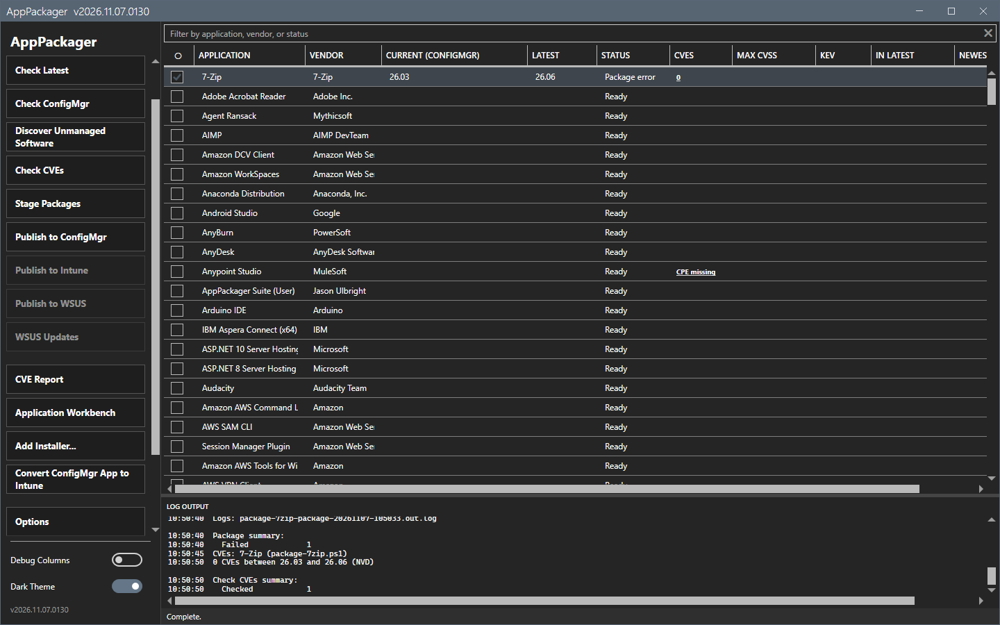
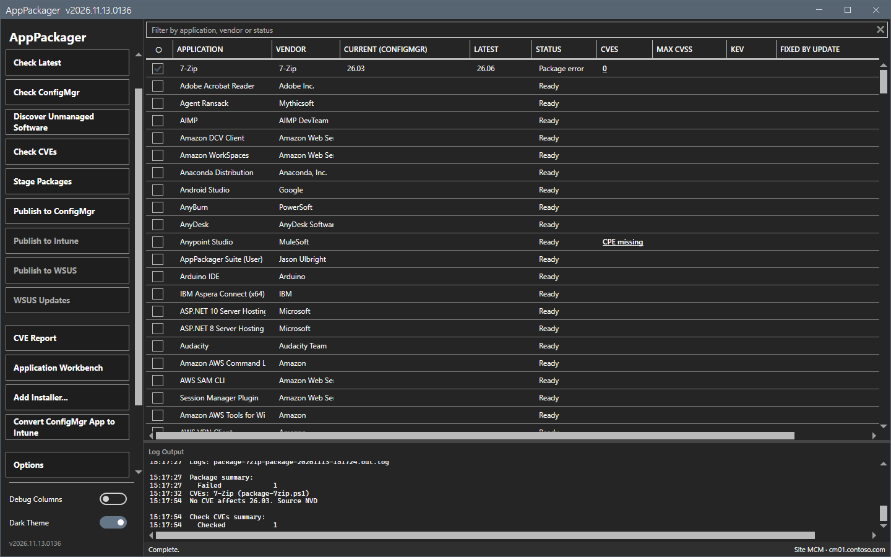
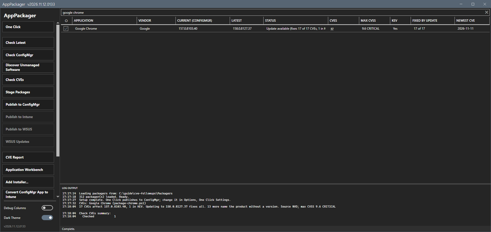
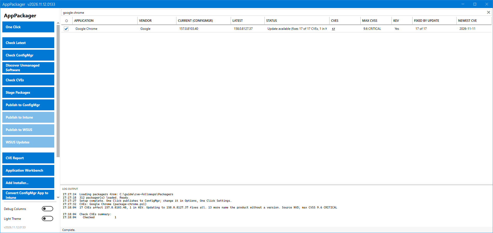
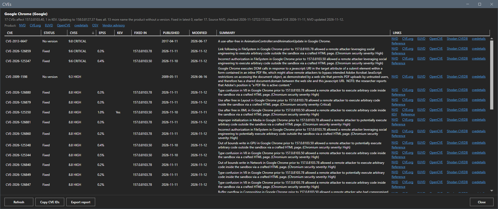
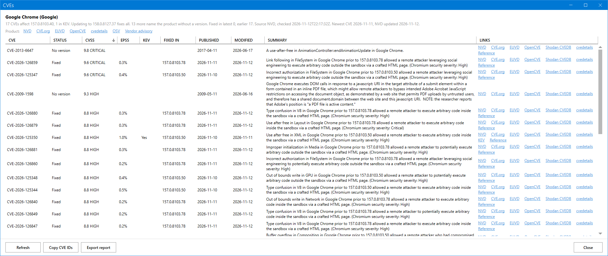
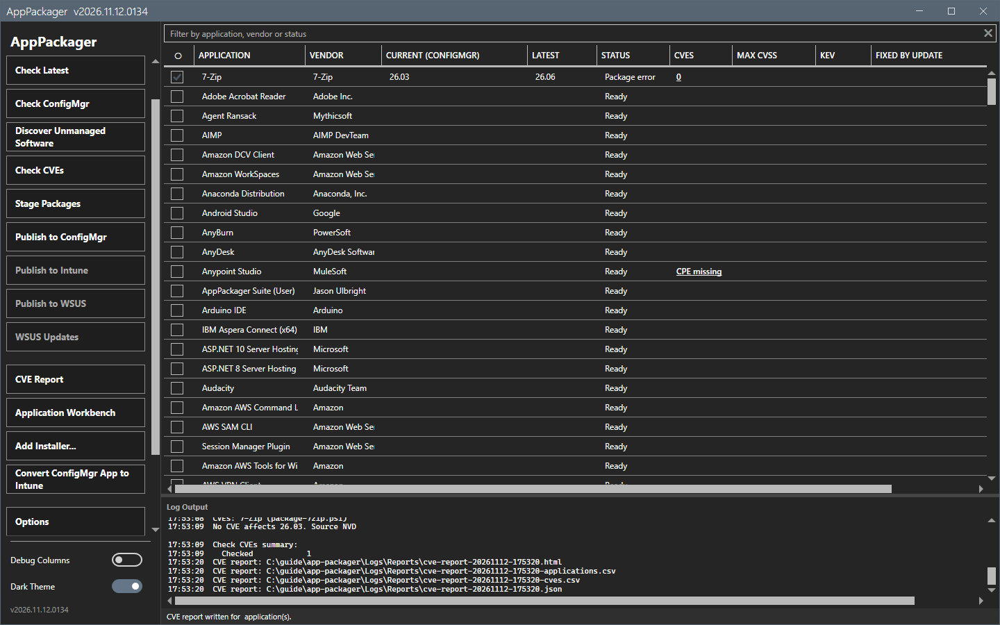
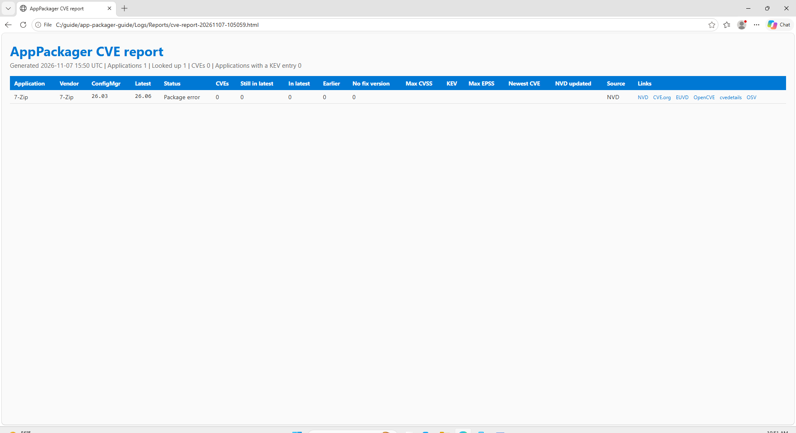

# Check CVEs and the CVE report

Check CVEs lists the vulnerabilities that affect the version of an application on your site. It also says which of them the latest version fixes.

## What it does

For each checked application, the tool reads every record that the National Vulnerability Database (NVD) holds for the product. The product is the CPE name in the packager. The tool then decides, from the affected versions of each record, which records apply:

- A CVE **affects** a version when a record names that version, or names a version range that holds it.
- A CVE is **Fixed** when it affects the version on the site and the latest version is not affected. The update removes it.
- A CVE is **Open** when it affects the version on the site and no known update removes it. This is the case when the latest version has it too, when the site already has the latest version, or when the record names the latest version with no version data.
- A record with **no version** names the product and states no version or range. NVD does not say which versions it affects. The tool lists such a record apart and does not count it.

The tool adds the EPSS score and the flag of the Known Exploited Vulnerabilities (KEV) catalog to each CVE.

### Which version is examined

| The row has | The tool examines | The result |
|---|---|---|
| A ConfigMgr version and a newer latest version | The ConfigMgr version | Each CVE is Fixed or Open. |
| A ConfigMgr version and no newer latest version | The ConfigMgr version | Each CVE is Open. |
| A latest version only | The latest version | Each CVE is Open. |

## When to use it

Use it to decide which updates are urgent, and to see which vulnerabilities stay after an update.

## Requirements

- A `CPE` header in the packager.
- One version: a version from Check ConfigMgr, or a latest version from Check Latest. A row that lacks a requirement shows the reason in the **CVEs** column: `CPE missing` or `No version`.
- Access to `services.nvd.nist.gov`, `api.first.org` and `www.cisa.gov`. See [Network](../reference/network.md).

## Steps

### Check the CVEs

1. Check the rows. Run [Check Latest and Check ConfigMgr](versions.md) first to get both versions.
2. Select **Check CVEs**. A progress overlay shows.

3. Wait for the status `Complete.` The columns fill in. The log shows a line for each application, for example `15 CVEs affect 23.01, 1 in KEV. Updating to 25.01 fixes 5 and leaves 10.`

| Column | Content |
|---|---|
| **CVEs** | The number of CVEs that affect the examined version. `Not in NVD` means that NVD holds no record under the product name. See [A product that NVD does not know](#a-product-that-nvd-does-not-know). Select the cell to open the CVE window. |
| **Max CVSS** | The highest CVSS score among those CVEs, with its severity. |
| **KEV** | `Yes` when one of those CVEs is in the KEV catalog. |
| **Fixed by update** | `5 of 15`: the update to the latest version removes 5 of the 15 CVEs. Empty when the row has no update. |
| **Newest CVE** | The most recent publication date among those CVEs. |

The **Status** column of a row with an update shows the same result in words, for example `Update available (fixes 5 of 15 CVEs, 1 in KEV)`.

### Read the CVE window

Select the count in the **CVEs** column. The window shows one line that states the result, the product links, and one row for each CVE.

| Column | Content |
|---|---|
| **Status** | `Fixed`, `Open` or `No version`. |
| **Fixed in** | The end of the affected version range that NVD records for the product, for example `24.09`. `after 0.80` means that NVD gives an inclusive end only. For a Fixed CVE this is the fix that the site version lacks. For an Open CVE this is the fix that the latest version lacks. It is usually the fix version of the vendor, but the vendor did not confirm it. |

**Refresh** looks the CVEs up again and ignores the saved result. **Copy CVE IDs** copies the IDs of the CVEs that affect the examined version. **Export report** writes the report for this application. Only `https` links open.

The next images show the check for Google Chrome. The site version is 157.0.8103.40 and the latest version is 158.0.8127.37. The main window shows 17 CVEs, a maximum CVSS of 9.6, one CVE in the KEV catalog, and `17 of 17` in **Fixed by update**.

The CVE window for Chrome 157.0.8103.40 with the latest version 158.0.8127.37 is sorted by CVSS. CVE-2026-126859 has CVSS 9.6 and the status `Fixed`: the update fixes it, and **Fixed in** shows 157.0.8103.78. CVE-2026-125347 also has CVSS 9.6 and is fixed.

### Write the CVE report

1. Check the rows. With no row checked, the report covers all rows.
2. Select **CVE Report**. The tool writes these files in the folder `Logs\Reports`: an HTML page, two CSV files, a workbook, a Markdown file and a JSON file. Each name starts with `cve-report-<timestamp>`. The status bar says `CVE report written`.

3. The HTML page opens in the browser.

The report uses the saved results. It makes no lookup. A row that Check CVEs did not look up shows `Not checked`.

## How the tool decides

### The product

The `CPE` header of a packager names the product: `cpe:2.3:a:<vendor>:<product>:*:*:*:*:*:*:*:*`. The tool asks NVD for the vendor and the product only, and gets every record of the product in one read. The version field of the header is not used.

- A header can hold more than one CPE, with a comma, a semicolon or a space between them. Use this when NVD files one product under two names. A CVE counts once.
- The fields edition, software edition and target hardware limit the records when the header states them. For example, `cpe:2.3:a:mozilla:firefox:*:*:*:*:esr:*:*:*` reads only the ESR ranges of a record that tells ESR and the release line apart. The value `-` in a field means the product without an edition. The value `*` states nothing.
- Only records for Windows, or for no named platform, count. A record for the Android, iOS, Linux or macOS build of a product does not count.

### A product that NVD does not know

NVD makes a product name when it files the first CVE of the product. When NVD holds no record under the name in the `CPE` header, the tool cannot tell these two cases apart:

- The product has no known CVE.
- NVD files the product under another vendor or product name. For example, NVD files VeraCrypt as `idrix:veracrypt` and draw.io as `diagrams:drawio`.

A count of 0 from such a lookup says nothing about the version. The tool shows `Not in NVD` in the **CVEs** column and `Update available (product not in NVD)` in the **Status** column. The CVE window and the log say `NVD holds no CVE record under the product name of the CPE header.` The report marks the count with `not in NVD`, and its head counts these applications. The column `NVDRecords` of the applications CSV file holds the number of records that NVD has for the product.

To find the name that NVD uses, search the product in the [NVD CPE dictionary](https://nvd.nist.gov/products/cpe/search), or open a CVE of the product in NVD and read its configurations. Then correct the `CPE` header.

Some products have no CVE record under their own name because NVD files the vulnerabilities of the component that they contain. The OpenJDK builds (Eclipse Temurin, Amazon Corretto, Microsoft Build of OpenJDK, BellSoft Liberica) are an example: NVD files Java vulnerabilities under the Oracle product names. These rows show `Not in NVD`.

### The versions

- The tool compares versions in any vendor form. Numbers compare as numbers, and a missing part counts as zero: `1.0` equals `1.0.0.0`.
- A pre-release word sorts before the release: `2.0.0-rc1` is before `2.0.0`. A patch letter sorts after it: `1.1.1w` is after `1.1.1k`, and `7.60c` is after `7.60`.
- Channel words such as `esr` and `lts` do not change the order.
- The text after a `+` is a build label and is not used: `11.0.30+7` is release `11.0.30`.
- A ConfigMgr version from an MSI can have a fourth build part that the vendor version does not, for example `26.2.2.2` against `26.2.2`. The tool drops that build part only. A patch of the vendor line stays: `131.0.3` against latest `132.0` is examined as `131.0.3`.

### Records with no version

Some NVD records name a product with no version and no range. Most of them are old. Such a record cannot exclude any release, so it would show as a vulnerability of every version for all time. The tool lists these records with the status `No version` in the CVE window and in the report. It does not count them in any column.

### When NVD does not answer

1. The tool uses the records that it saved for the product, if it has them. The result names the date of those records.
2. Without saved records, the tool asks Shodan CVEDB for each version. Shodan CVEDB gives no version ranges, so the tool compares its answers for the two versions.
3. When both fail, the row shows `Error`. A failed lookup is not saved, and an earlier result stays in place.

## Options and settings of this page

| Setting (Options > ConfigMgr Preferences) | Effect |
|---|---|
| NVD API key | Raises the NVD limit from 5 to 50 requests in 30 seconds. The variable `NVD_API_KEY` does the same. |
| Look up CVEs after Check ConfigMgr | Chains Check CVEs after Check ConfigMgr. |

## Limits

- NVD allows 5 requests in 30 seconds without a key. The first lookup of a product reads all its records: one request for each 2000 records. A large run is slow without a key.
- The tool saves the records of each product in `%LOCALAPPDATA%\AppPackager\vuln-products` and the result of each lookup in `%LOCALAPPDATA%\AppPackager\vuln-results`. It uses both for six hours. A second lookup of the same product with other versions makes no NVD request in that time.
- The result is as correct as the NVD record. When NVD lists a wrong range for a CVE, the tool reports that CVE for the wrong versions.
- A CVE that NVD has not yet analyzed has no version data and does not show.
- The first screenshots on this page show an application with no CVE. The Chrome screenshots use a site version that the capture wrote to the packager history, and the NVD records of 2026-11-12.

## Troubleshooting

| Message or symptom | Cause | Fix |
|---|---|---|
| `CPE missing` | The packager has no `CPE` header. | The row cannot be checked. |
| `No version` | The row has no ConfigMgr version and no latest version. | Run Check Latest or Check ConfigMgr. |
| `Error` | NVD and Shodan CVEDB did not answer, or a version has no number. | Read the log line of the application. Run Check CVEs again later. |
| `Not in NVD` | NVD holds no record under the product name of the `CPE` header. The product has no known CVE, or NVD files it under another name. | Search the product in the NVD CPE dictionary. When NVD uses another name, correct the `CPE` header. See [A product that NVD does not know](#a-product-that-nvd-does-not-know). |
| The count is 0 for a product with known CVEs. | The CVEs do not affect the examined version, or NVD files them under a second product name. | Open the NVD link of the CVE window and compare the CPE name and the version ranges. Add the second name to the `CPE` header. |
| The run is slow and repeats. | NVD throttles calls without a key. | Set an NVD API key. |
| The source says `records saved ...; NVD did not answer`. | NVD failed and the tool used the saved records. | Run Check CVEs again later. |

## Links

- [Check Latest and Check ConfigMgr](versions.md)
- [Network](../reference/network.md)
