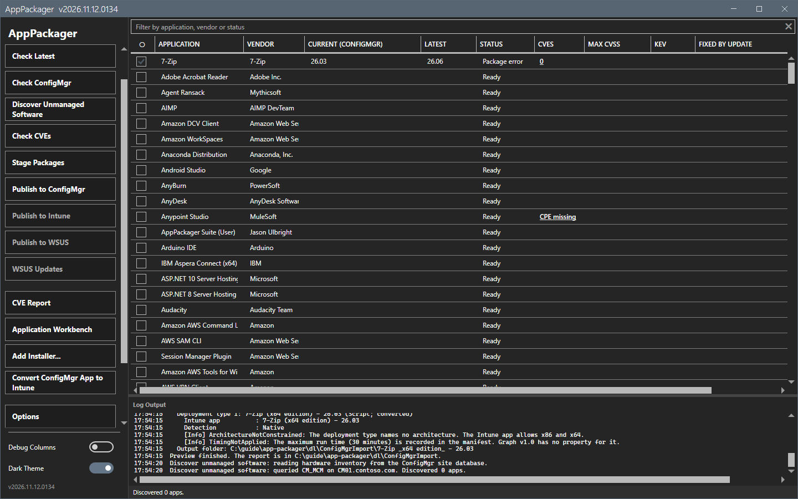

# Discover Unmanaged Software

Discover Unmanaged Software finds applications that clients already run and that the site does not manage.

## What it does

It reads the site database, and compares the hardware inventory of Add/Remove Programs with the packagers that the Product Filter hides. It offers the packagers that match as candidates.

A hidden packager is a candidate when all of these are true:

- Hardware inventory shows the application on at least one client.
- The site has no application for the packager's ConfigMgr name.
- The packager is not on the list of applications that are not offered.
- The packager has an `ArpName` that is not `none`.

## When to use it

Use it to find out which packagers are worth turning on for your site.

## Requirements

- A domain account on a domain-joined computer. Discover uses Windows authentication only.
- The right `db_datareader` on the site database `CM_<site code>`.
- The hardware inventory classes Add/Remove Programs and Add/Remove Programs (64) in the client settings. Without them the result says `no inventory data`.
- A site code, or both **Discovery SQL** and **Discovery DB** in Options.

## Steps

1. Select **Discover Unmanaged Software**. The tool reads the site database. A progress overlay shows. **Cancel** stops the scan.

2. Wait for the end. When the tool finds candidates, a window shows `Discovered N apps. Enable console view?` with the application, the vendor and the inventory name. Choose a button:
   - **Enable Selected** shows the checked applications in the grid.
   - **Enable All** shows every application of the list.
   - **Not Now** closes the window. The next discovery offers the applications again.
   - **Don't ask again for selected** hides the checked applications from later discoveries.
3. When there are no candidates, no window opens. The status line shows the result of the inventory.

## Options and settings of this page

| Setting (Options > ConfigMgr Preferences) | Effect |
|---|---|
| Discovery SQL, Discovery DB | The SQL server and the database. Leave both empty to use the values of the site. |
| Not Offered | Shows how many applications Discover leaves out. **Clear List** empties it. |

## Limits

- The views of the database bypass the role-based administration of the console. Give `db_datareader` only to accounts that may read the inventory of all clients.
- Discover reads distinct software titles and application names. It reads no client name and no client count, and it writes nothing.
- A scan stops after 600 seconds.
- A per-user install is not in the machine-wide inventory.
- Some packagers share one Add/Remove Programs name with a sibling, for example Citrix Workspace Current Release and LTSR. Discover offers the owner of each group.

## Troubleshooting

| Message or symptom | Cause | Fix |
|---|---|---|
| `Windows authentication to SQL Server <server> failed.` | The computer is not in the domain, or the SQL service principal name is wrong. | Run as a domain account on a domain-joined computer. |
| The status says `no inventory data`. | The client settings do not collect Add/Remove Programs. | Turn on the inventory classes. |

## Links

- [Options dialog](options.md)
- [Main window](main-window.md)
