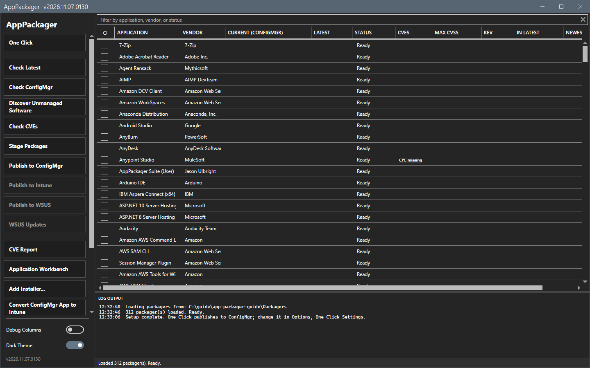
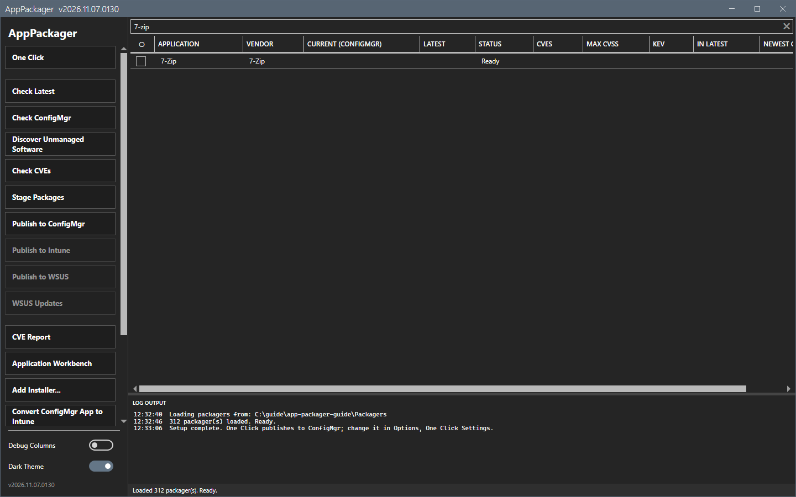
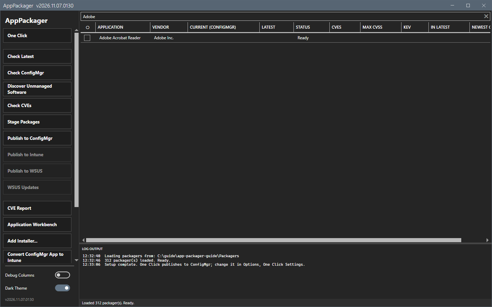
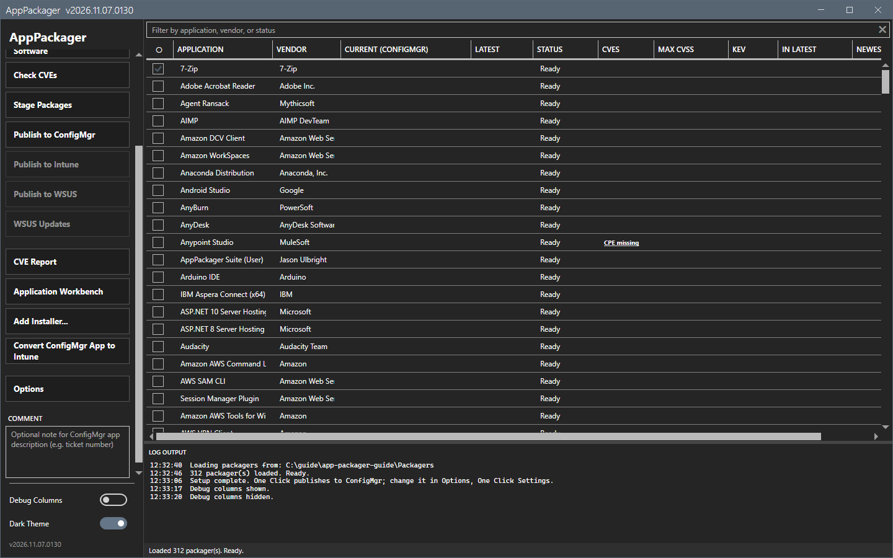
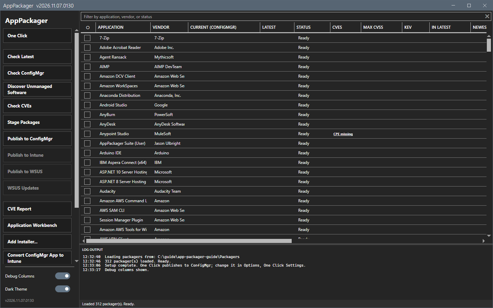
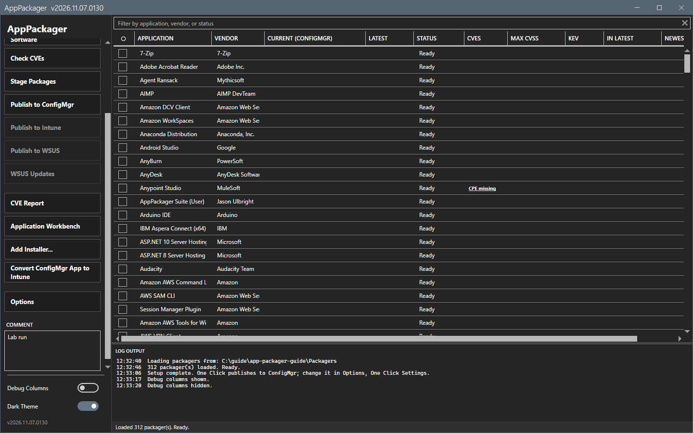
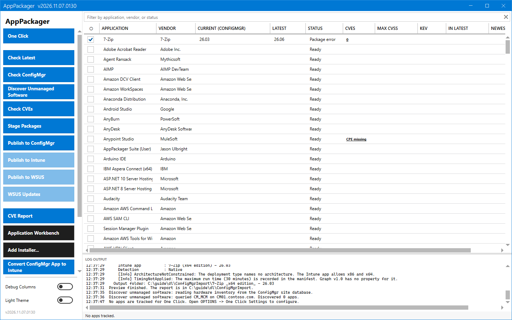

# Main window

The main window lists the applications and holds the actions in a sidebar.

## What it does

The grid shows one row for each packager. Its columns show the application, the vendor, the version that Configuration Manager has, the latest version, the status and the CVE data. The sidebar starts the actions for the checked rows. The log at the bottom shows what each action does.

## When to use it

Use it to choose the applications that an action works on, and to read the result.

## Requirements

None. The window loads the packager scripts from disk. It makes no vendor call and no site call when it opens. A background update check can contact GitHub once in 24 hours. See [Network](../reference/network.md).

## Steps

### Read the window

1. The sidebar has these actions: **One Click**, **Check Latest**, **Check ConfigMgr**, **Discover Unmanaged Software**, **Check CVEs**, **Stage Packages**, **Publish to ConfigMgr**, **Publish to Intune**, **Publish to WSUS**, **WSUS Updates**, **CVE Report**, **Application Workbench**, **Add Installer...**, **Convert ConfigMgr App to Intune** and **Options**.
2. A publish button that is not ready is disabled. Hover over it to read what is missing.
3. The status bar at the bottom shows the state of the last action, for example `Loaded 312 packager(s). Ready.`

### Find an application

Type in the filter box above the grid. The grid keeps the rows that match the application, the vendor or the status.

### Check the applications to work on

1. Select the box at the start of a row.

2. The box in the column header cycles through none, all rows, only the rows that have an update, and none. It acts on the rows that the filter shows.
3. Select an action in the sidebar. It works on the checked rows.

### Show more columns

Turn on **Debug Columns** at the bottom of the sidebar. The grid then shows more columns, for example the ConfigMgr name, the script, the vendor URL and the time of the last check.

### Add a comment

Type text in the field under **Options**. The tool stores it as the administrative comment of the applications that it creates in that run.

### Switch the theme

Use the **Dark Theme** switch at the bottom of the sidebar. The window size, the position, the theme and the debug columns are saved.

## Options and settings of this page

| Control | Effect |
|---|---|
| Filter box | Narrows the grid as you type. |
| Row box | Checks the row for the next action. |
| **Debug Columns** | Shows more columns. |
| Comment field | Sets the administrative comment of the run. |
| Theme switch | Dark or light. |

A right-click on a row opens a menu with **Edit application**, **Open Log Folder**, **Open Staged Folder**, **Open Network Share** and **Copy Latest Version**. A Ctrl+click on a row opens the product page of the vendor. This guide did not capture the menu.

## Limits

- Long runs over many applications run in the background, with a progress overlay. You can pause, resume or cancel them.
- The window keeps the newest 4,000 lines of the log. The files on disk stay complete.

## Troubleshooting

| Message or symptom | Cause | Fix |
|---|---|---|
| The grid shows fewer applications than 312. | The Product Filter hides some. | Open **Options > Product Filter**. |
| A row says `Package error`. | The Package phase failed. | Read the log. See [Stage and Publish to ConfigMgr](stage-publish.md). |

## Links

- [Check Latest and Check ConfigMgr](versions.md)
- [Options dialog](options.md)
