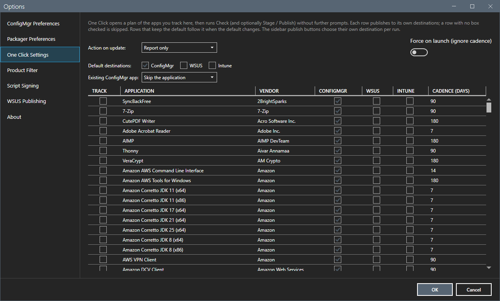
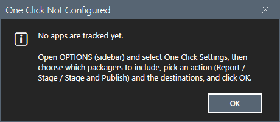

# One Click

One Click is the unattended run for the applications that you track: it plans the run, runs it and writes a report.

## What it does

One Click runs Check Latest for each tracked application. With the action **Report only**, it stops after the check. With **Stage**, it also stages an application that has an update. With **Stage and Publish**, it also publishes to the destinations that you chose. It asks nothing during the run. An application that exists already follows the policy that you saved in Options, Updates and CVEs, One Click.

## When to use it

Use it to keep a fixed set of applications current with one click, or from a schedule.

## Requirements

- Tracked applications and destinations in **Options > Updates and CVEs > One Click**.
- The settings of every destination that you use. See [Options dialog](options.md).

## Steps

### Choose what One Click tracks

1. Select **Options**, then **Updates and CVEs**, then **One Click**.
2. Select **Track** for each application. Choose the action: **Report only**, **Stage** or **Stage and Publish**. Choose the default destinations and, for a row, its own destinations. A row without a destination is skipped.

### Open the plan

1. Select **One Click**. The plan window opens. It has one row for each tracked application: the version of the last check, the destination boxes, the version last published to each destination, the planned steps and the reason for each skip.
2. Read the count line, for example `12 application(s), 2 skipped: 9 to ConfigMgr, 4 to WSUS, 0 to Intune`.
3. Select **Plan Only** to keep the plan without a run, or start the run.

When no application is tracked, the button shows the message `One Click Not Configured` and no plan opens. The lab of this guide had no tracked application, so this guide captured that message and not the plan window. It did not start a run, and it did not check the plan window.

### The run and the report

During the run, the grid becomes a progress grid. A failed application does not stop the next one. Pause and Cancel stay on the main window. At the end, the tool writes `Logs\OneClick\one-click-<timestamp>.md` and `.json`: the start, the end, the operator, the computer, the action, and for each application the version, the result for each destination and the reason for each skip. **Open report** opens the last report. **Run history** opens the folder.

## Options and settings of this page

| Setting | Effect |
|---|---|
| Track | Adds the application to the One Click set. |
| Action | Report only, Stage, or Stage and Publish. |
| Destinations | ConfigMgr, WSUS, Intune, by default and for each row. |
| Policy for an existing application | Overwrite or Skip, applied without a question. |
| **Force** | Ignores the guard that skips a version that a destination already has. |

## Limits

- A version that a destination already has is not published there again, unless **Force** is set. The tool reads the history from `%LOCALAPPDATA%\AppPackager\app-history.json`.
- A destination that refused a version is not tried again for that version unless **Force** is set.
- An application without its local source folder is dropped before the run starts.

## Troubleshooting

| Message or symptom | Cause | Fix |
|---|---|---|
| The plan window shows no rows. | No application is tracked. | Track applications in Options, Updates and CVEs, One Click. |
| A row is skipped. | The destination has the version, or has no box checked. | Read the reason in the row. Use **Force** to publish again. |

## Links

- [Options dialog](options.md)
- [Stage and Publish to ConfigMgr](stage-publish.md)
