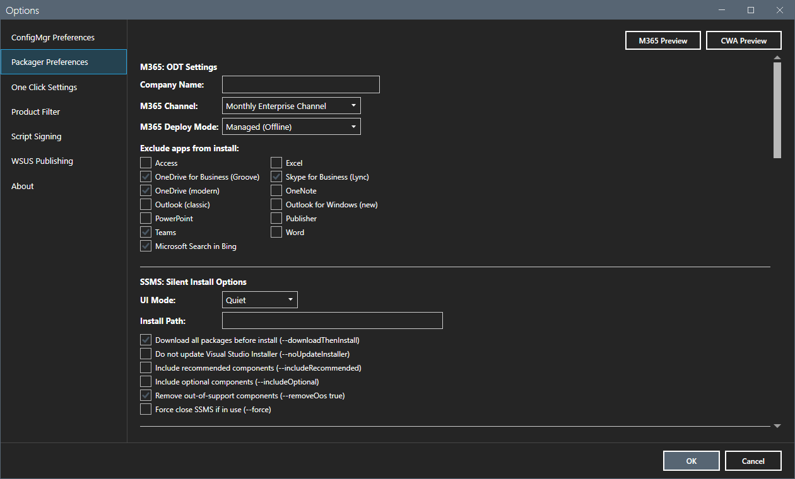
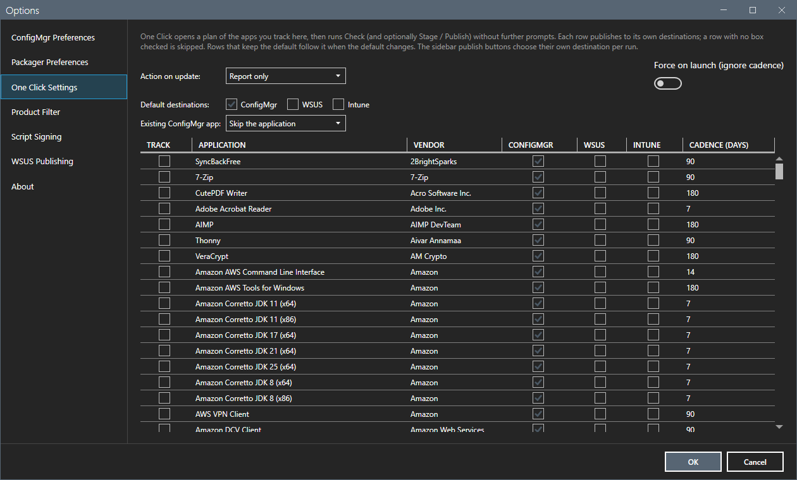
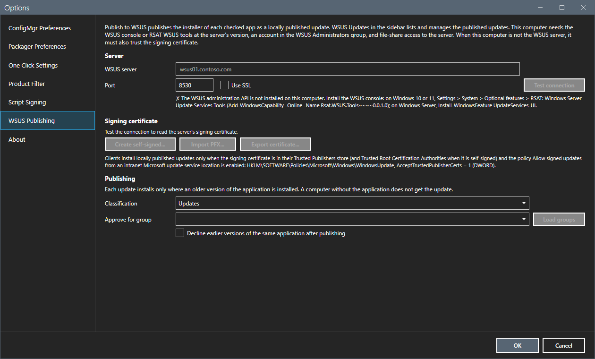

# Options dialog

The Options dialog holds every setting of AppPackager. It has a list of pages on the left and the settings of the chosen page on the right.

## What it does

**OK** saves the changes of every page in one step. **Cancel** discards them all. There are seven pages: **ConfigMgr Preferences**, **Packager Preferences**, **One Click Settings**, **Product Filter**, **Script Signing**, **WSUS Publishing** and **About**.

## When to use it

Use it after the Setup window, when a site, a share or a destination changes, and to set the preferences that packagers read when they stage.

## Requirements

None.

## Steps

### ConfigMgr Preferences

Select **Options**. The first page opens.

The page sets the **Systems in use**, the site code, the provider machine, the file share root, the content layout and the download root. It also sets the runtime, the content options, the distribution, the test deployment and the application title. At the bottom it shows the detection of the tools: the **Console** (found or not), **7-Zip CLI** and the **GitHub API**. The page continues below the visible part with the NVD key, the CVE option and the discovery settings.

Without the console, the page shows `Not detected` for it. The buttons that need the console are disabled.

### Packager Preferences

The page groups the settings that packagers read at stage time: the Microsoft 365 settings (company name, channel, deploy mode, excluded apps), the SSMS install options, DBeaver, Adobe Acrobat Reader, Beyond Compare 5, TeamViewer Host, Citrix Workspace App and the folders for locally downloaded installers. **M365 Preview** and **CWA Preview** show the generated configuration.

### One Click Settings

The page chooses what the [One Click](one-click.md) button does: the action on an update, the default destinations, the policy for an existing ConfigMgr application, and for each application the Track box, its destinations and its cadence in days.

### Product Filter

The page shows or hides single packagers in the main grid, grouped by vendor. **Select All** and **Select None** help. The hidden applications are saved.

### Script Signing

The page sets the Authenticode signing of the scripts that AppPackager stages: which kinds are signed, which signatures are required, the certificate store and the certificate, and the timestamp server. **Test signing configuration** signs and verifies a temporary file. A required signature that fails stops the build. There is no unsigned fallback.

### WSUS Publishing

The page sets the WSUS server, the port, SSL, the classification, the approval group and the signing certificate. See [Publish to Intune and Publish to WSUS](publish-intune-wsus.md).

### About

The page shows the name, the installed version, the license, the link to the repository, the time of the last update check and the latest known release. **Update now** shows here when a newer release exists.

The light theme gives the same dialog.

## Options and settings of this page

| Page | What it sets |
|---|---|
| ConfigMgr Preferences | Systems, site, share, download root, runtime, content options, distribution, title rule, NVD key, discovery. |
| Packager Preferences | Settings that packagers read at stage time. |
| One Click Settings | The tracked set and its destinations. |
| Product Filter | Which packagers show in the grid. |
| Script Signing | Authenticode signing of staged scripts. |
| WSUS Publishing | The WSUS destination. |
| About | Version and update check. |

## Limits

- The settings are saved in `AppPackager.preferences.json` in the install folder. Some packager values are copied to `Packagers\packager-preferences.json`.
- A scheduled version monitor has its own configuration file. See [Files and logs](../reference/files-and-logs.md).

## Troubleshooting

| Message or symptom | Cause | Fix |
|---|---|---|
| **Console** shows `Not detected`. | The console is not installed, or its module is not found. | Install the console, or set `SMS_ADMIN_UI_PATH` to its `bin\i386` folder. Start the tool again. |
| **GitHub API** shows `Anonymous`. | No token is set. | Set `GITHUB_TOKEN` or `GH_TOKEN`, or run `gh auth login`. |
| A signing test fails. | No certificate is chosen, or the key needs a PIN. | Choose a certificate by thumbprint. |

## Links

- [Getting started](../getting-started.md)
- [Settings](../reference/settings.md)
