# Options dialog

The Options dialog holds every setting of AppPackager. It has a tree of sections on the left and the section on the right.

## What it does

**OK** saves the changes of every section that you opened, in one step. **Cancel** discards them all. The tree has seven top-level nodes: **Connections**, **Packaging**, **Applications**, **Updates and CVEs**, **Security**, **Tools** and **About**. The window title names the section that is open.

The search box above the tree finds a setting by name. Type a name, for example `sql port`. The list of matches replaces the tree. Press Enter to open the first match, or select another one. The window opens the section and puts the cursor in the field.

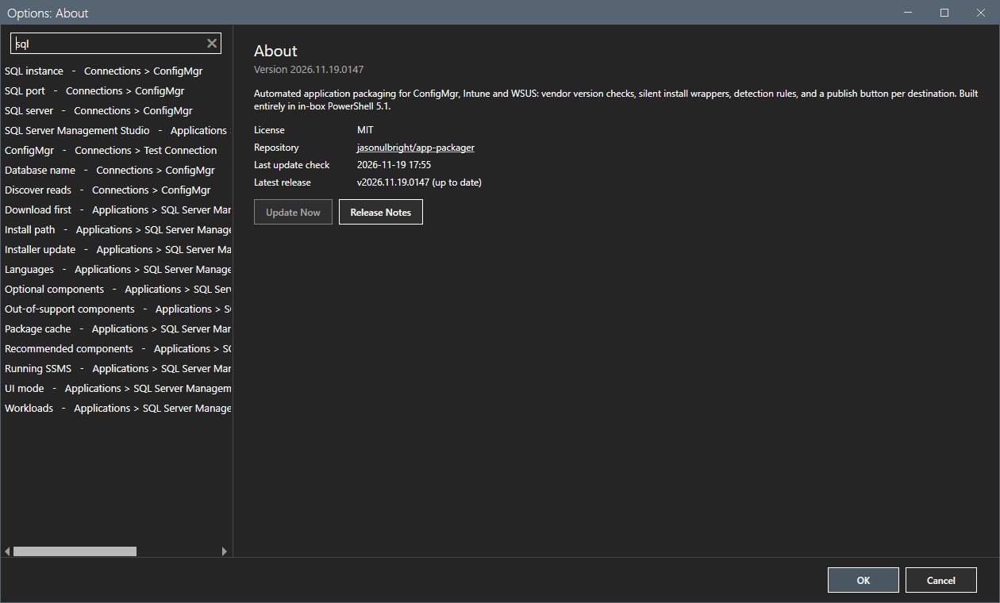

A value that cannot be stored stops the save and opens its field. A port outside 1 to 65535 is one example.

The footer of the main window shows the saved site code and site server. Options and Setup are the only places where you change them. The Setup window and the Connections sections use the same fields. A value that you type in Setup is the value that Options shows.

## When to use it

Use it after the Setup window, when a site, a share or a destination changes, and to set the options that packagers read when they stage.

## Requirements

None.

## Steps

Select **Options**. The ConfigMgr section opens.

### Connections

#### Systems in Use

Select the systems that AppPackager publishes to. The sidebar disables the button of a system that is not selected.

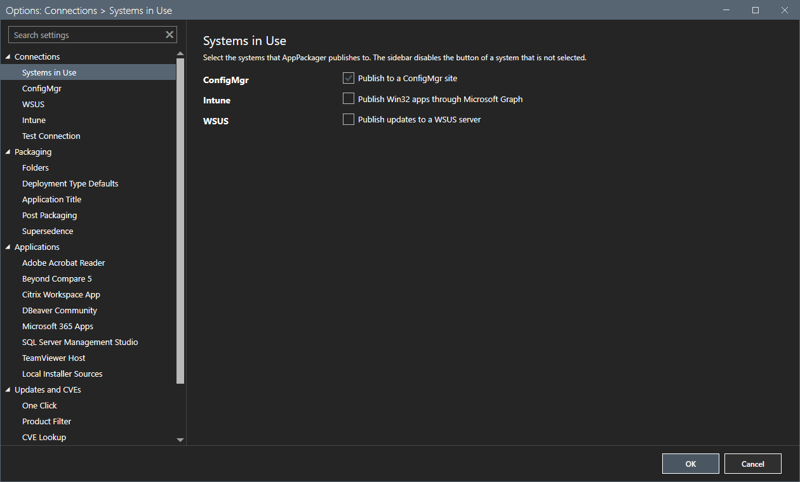

#### ConfigMgr

**Site code**, **Site server / SMS Provider**, the site database (**SQL server**, **SQL instance**, **SQL port**, **Database name**) and **Content share UNC**. Discover connects to `server\instance,port`. An empty database field takes its value from the site definition, and an empty database name means `CM_` and the site code. A name `server\instance,port` in the SQL server field shows split into the three fields. **Console status** shows whether the console is installed on this computer.

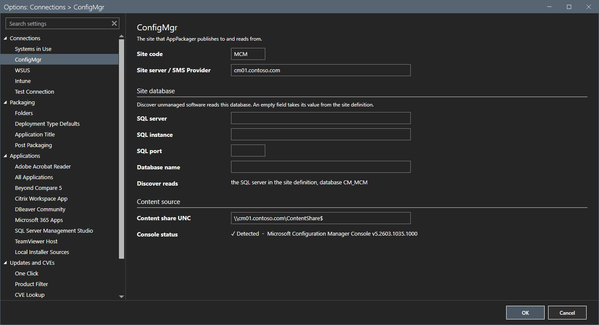

#### WSUS

The server, the **Port**, **Use SSL**, the signing certificate, the classification, the approval group and **Decline superseded**. The port is 8530 for HTTP and 8531 for HTTPS, and it follows **Use SSL** until you type a custom port. A port outside 1 to 65535 stops the save. See [Publish to Intune and Publish to WSUS](publish-intune-wsus.md).

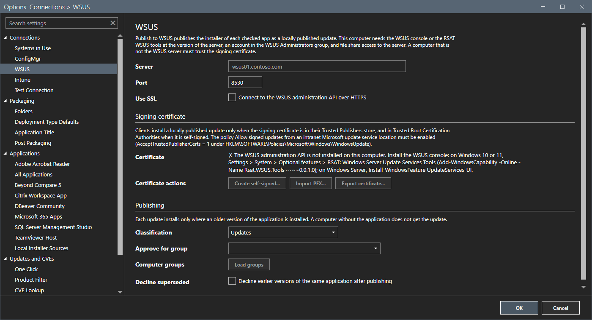

#### Intune

**Tenant ID**, **Client ID** and **Client secret** of the app registration. The secret is stored with DPAPI for the current Windows user. An empty box keeps the saved secret.

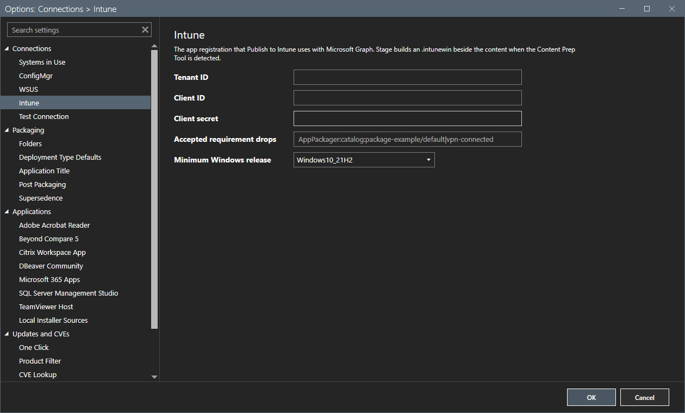

#### Test Connection

One button for each system. ConfigMgr reads the SMS Provider and opens the site database. WSUS connects to the server. Intune requests a Graph token. Each test uses the values that are in the fields, before you select OK.

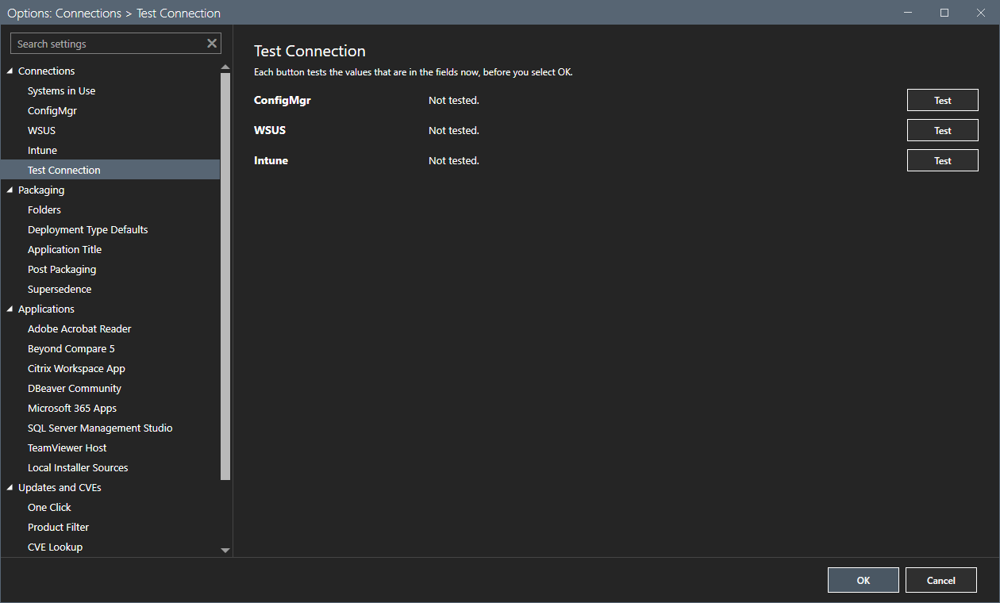

### Packaging

#### Folders

**Download root**, the **Packagers folder** and **Content layout**.

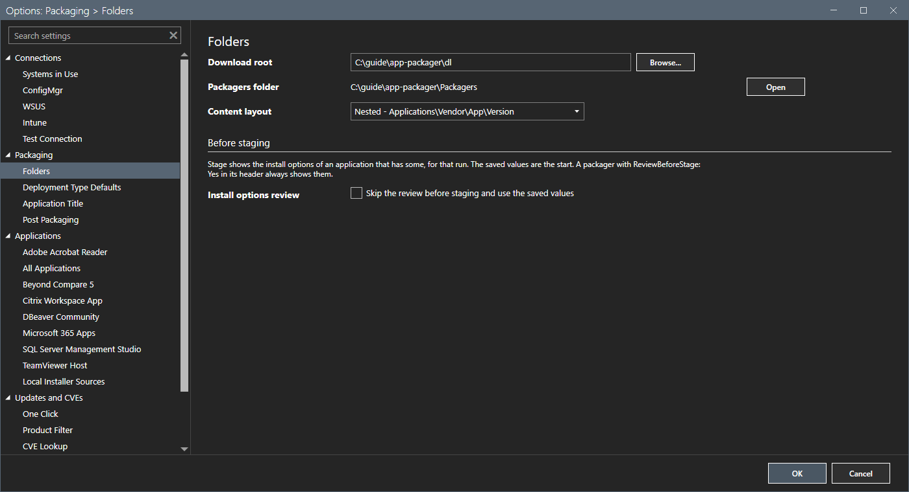

#### Deployment Type Defaults

The estimated and maximum runtime, **Fallback distribution points** and **Neighbor/default DP** of every deployment type that Publish to ConfigMgr creates.

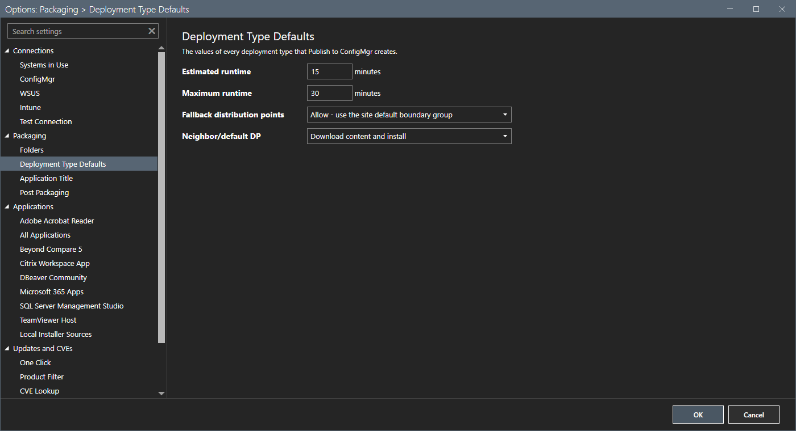

#### Application Title

**Include version** and **Remove version**. Without a selection, a packager uses its own name. While supersedence is on for an application (the default or the choice of that application), a note says that the version is added to its name when it is packaged. The note changes no setting: the box shows the choice that you made. The title of one application is set in [All Applications](#all-applications).

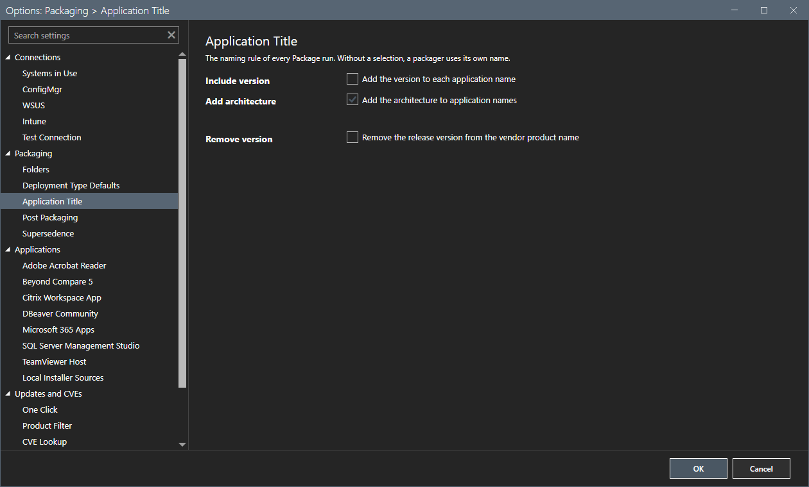

#### Post Packaging

**Distribute content**, **DP group**, **Test deployment**, **Test collection** and **Create collection**. The test deployment needs Distribute content and a DP group.

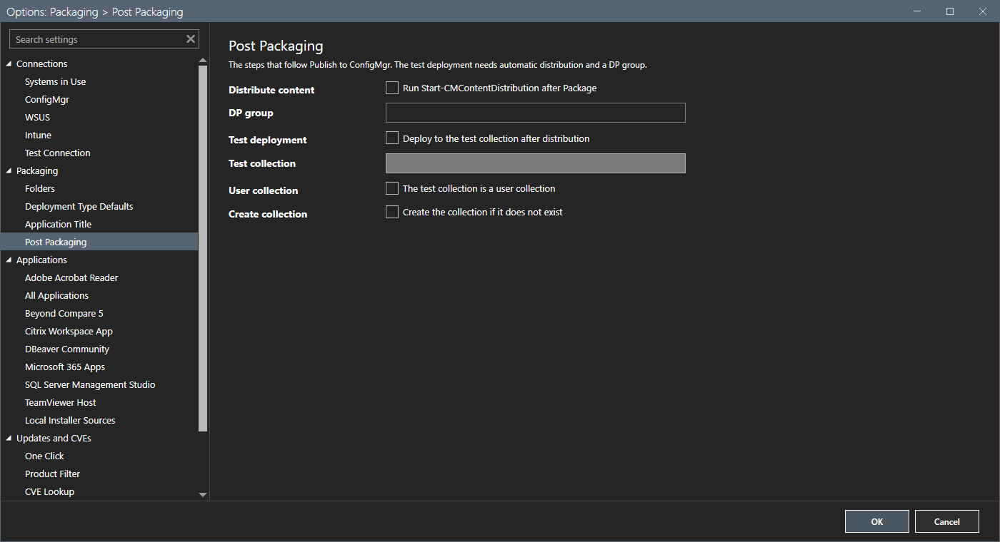

### Applications

#### Adobe Acrobat Reader

The edition, the languages of the multilingual edition, and the Adobe properties `EULA_ACCEPT`, `DISABLEDESKTOPSHORTCUT`, `ENABLE_CHROMEEXT`, `DISABLE_BROWSER_INTEGRATION` and `UPDATE_MODE`.

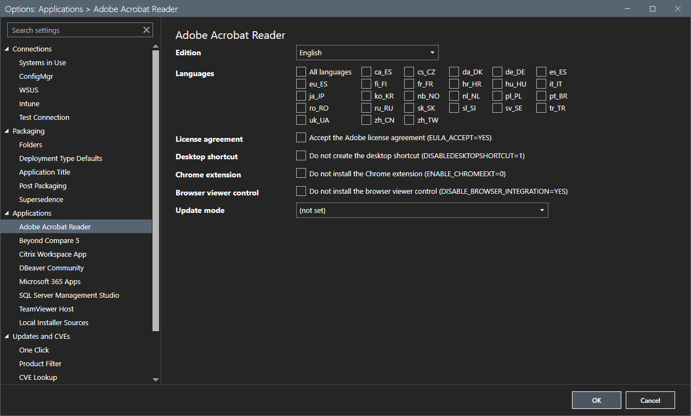

#### All Applications

One grid with one row for each application that the packagers offer. Every setting of one application is in this grid. The **Columns** button chooses the columns. The five columns that show first are Package Source, Install Scope, Supersedence, Version in Title and Version Rule. The search box shows only the applications whose name or vendor holds the text that you type. Select a column header to sort the grid.

| Column | Choices | Stored in |
|---|---|---|
| Package Source | Packager default, x64 and ARM64 | `DeploymentConditions.Apps`, `Split` |
| Install Scope | Packager default, System, User | `DeploymentConditions.Apps`, `InstallMode` |
| Supersedence | Follow the default, Off, Replace, Replace and uninstall | `Supersedence.TitleOverrides`, `Mode` |
| Version in Title | Follow the default, Include version, No version | `DeploymentConditions.Apps`, `TitleMode` |
| Version Rule | Follow the default, Minimum, Exact | `Supersedence.TitleOverrides`, `VersionRule` |
| Network | Any, VPN only, On site only | `DeploymentConditions.Apps`, `Network` |
| Network Split | None, Network split | `DeploymentConditions.Apps`, `Split` |
| Install Command, Uninstall Command | A command line. Empty keeps the command of the packager. | `CommandOverrides.Apps` |
| In One Click | No, Yes | `AppFlow.Tracked` |
| Check Interval Days | A number from 1 to 365. Empty uses the default. | `AppFlow.CadenceOverrides` |
| Publish to ConfigMgr, Publish to Intune, Publish to WSUS | Follow the default, Yes, No | `AppFlow.Destinations` |
| Estimated Runtime (min), Maximum Runtime (min) | A whole number from 1. Empty inherits the default. | Workbench profile, `Timing.EstimatedMinutes` and `Timing.MaximumMinutes` |
| Reboot After Install | Inherit, No reboot, Soft reboot, Hard reboot, Force restart | Workbench profile, `Install.RebootPolicy` |

The first choice of a column is the value that resets it. **Follow the default** uses the default in the three fields above the grid: **Version rule, ConfigMgr**, **Version rule, Intune** and **Supersedence mode, ConfigMgr**. The shipped defaults are Minimum, Minimum and Off. The version rule sets the operator of the version clause in the detection of the application that Package publishes. Exact writes `IsEquals` only when a value read from the installed product equals the expected value: the ProductVersion of an MSI, or a value that you record with `-RecordInstalledValue`. Replace makes the new application supersede the older version. Replace and uninstall also uninstalls it, and it needs the ConfigMgr version rule Exact. Supersedence is off for every application until you turn it on.

The last three columns are fields of the Workbench profile of the application, and they follow the rules of the Workbench: an empty value or Inherit removes the field from the profile, and any other value is a custom override. The grid writes them to the profile that the migration of the earlier settings makes (the profile with the name Migrated), and creates that profile in the same shape when the application has none. The profile becomes the active profile only while the application is on the packager default profile or on this profile. When another profile is active, the cells are closed and the tooltip names that profile, because a run reads the active profile only. The estimated runtime cannot be more than the maximum runtime. The detection, the requirements and the distribution targets are lists of rules. They stay in the [Application Workbench](workbench.md) and have no column.

A cell that does not apply to an application is closed, and its tooltip gives the reason. Package Source is open only for a packager that offers an architecture split (7-Zip, Google Chrome and Mozilla Firefox). A packager of a family with an x64, x86 or ARM64 sibling shows its own architecture, because the sibling is another row. Install Scope is open only for a packager that supports both install modes. Network Split is open only for a packager that offers it. Publish to WSUS is closed for an application that WSUS cannot carry, and the tooltip names the reason. A package source and a network split are both splits, and a packager stages one split at a time: the last one that you choose replaces the other.

While supersedence is on for an application, its title must hold the version, because the new release and the older one must be separate applications. The grid then shows **Include version** in Version in Title, and the cell is closed. A note under the buttons counts these applications. The grid keeps the choice that you made in that column: when supersedence is off again, the column shows your choice again.

The bar above the grid changes one column: **Set** a column **to** a value **for** Checked, Filtered or All, then press **Apply**. Checked is the applications whose box is checked, Filtered is the applications that the search shows, and All is every application. **None** resets the column for every application. **Check all** and **Check none** change the boxes. The bulk actions skip a cell that does not apply, and the line under the bar says how many cells they skipped. Nothing is saved until you choose **OK**.

The setting applies to Intune too. The Intune relation is the single Microsoft Graph beta call of the tool, because Graph v1.0 has no resource for app relationships. See [Supersedence in Intune](stage-publish.md#supersedence-in-intune). The grid writes only the keys of the table. A value that the grid does not own, such as a condition of the Workbench or a language list, stays as it was. The One Click page of Options edits the same One Click keys, and the grid saves after it. See [Settings](../reference/settings.md).

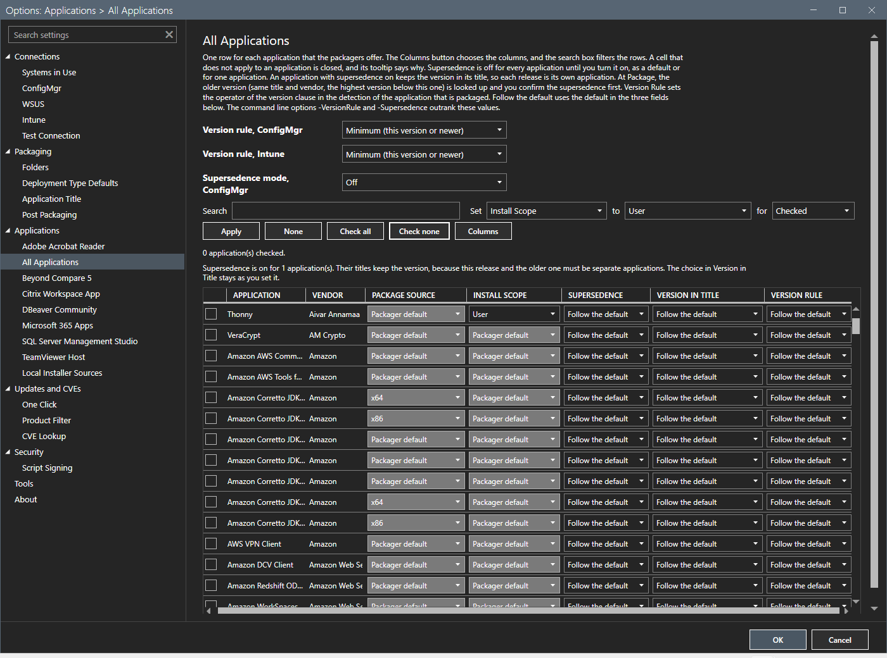

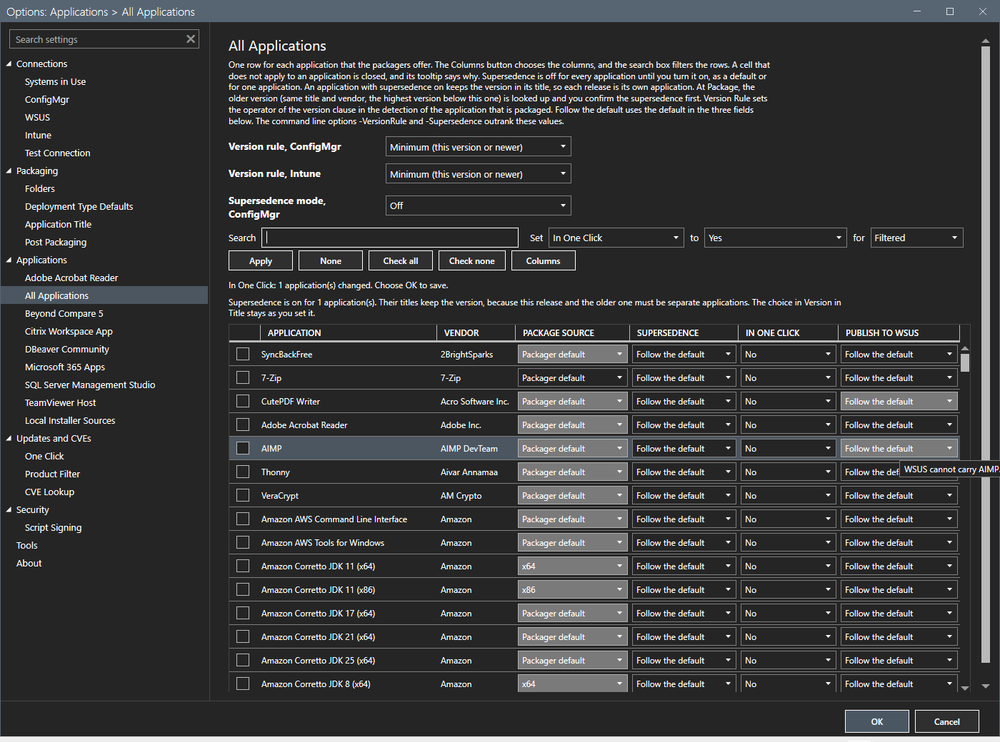

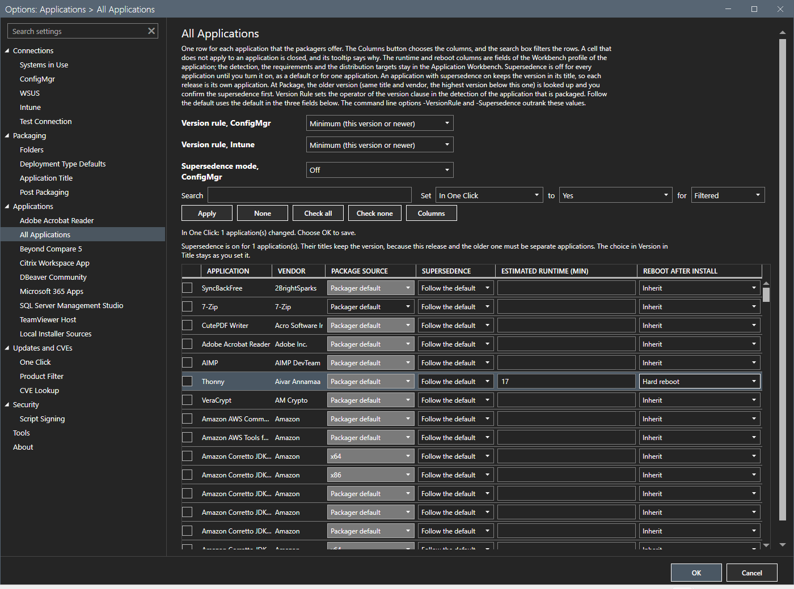

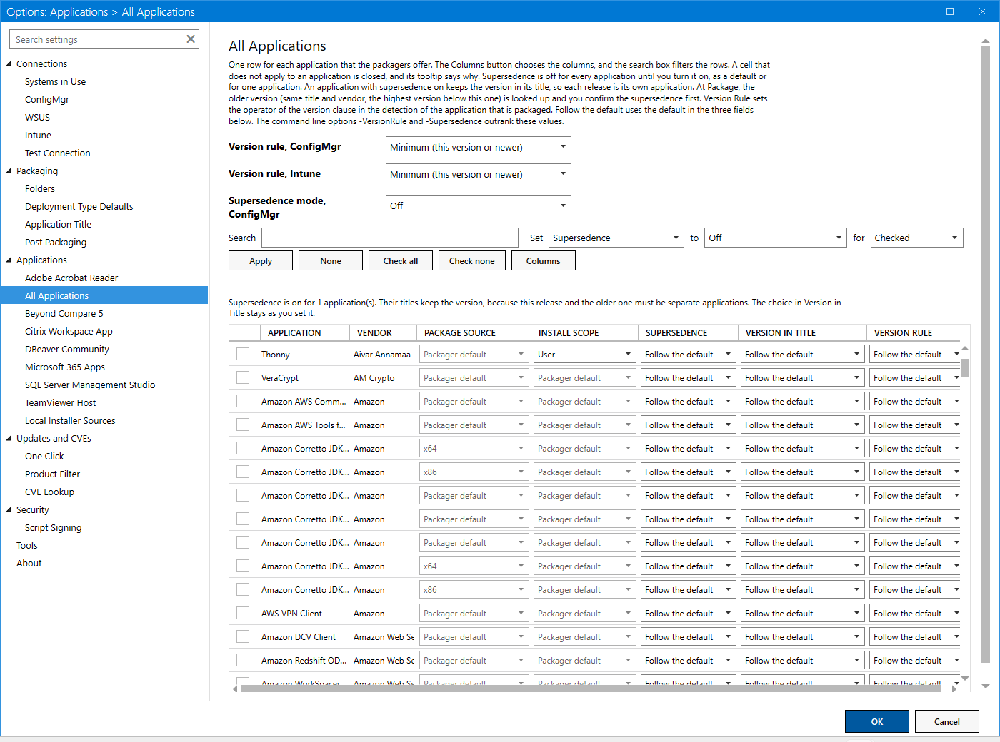

#### Beyond Compare 5

The **License key file** and the policy switches `/DisableRemoteProfiles` and `/DisableSavedPasswords`.

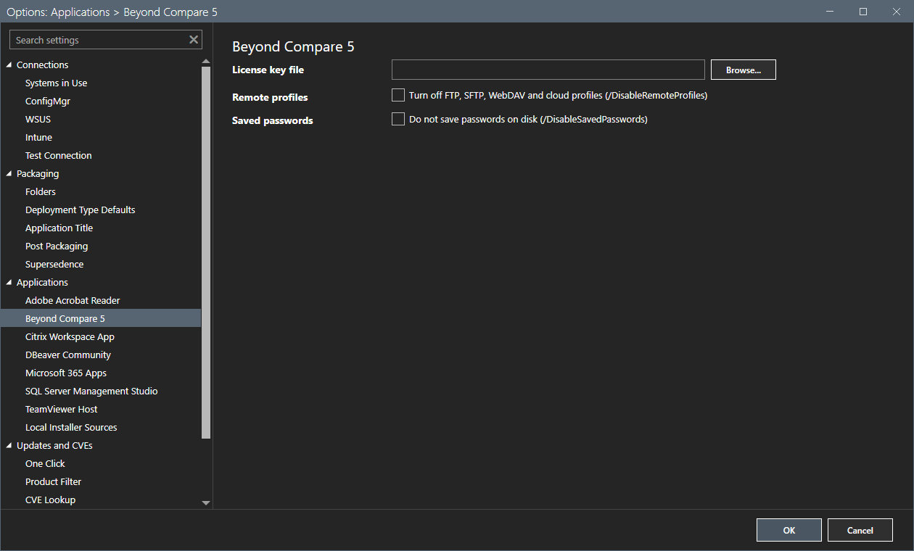

#### Citrix Workspace App

The **Preview** button shows the command line of the Current Release and LTSR packagers. Six groups on this one page set the switches.

**Store** - the store name and URL (`STORE0`).

**Installation** - `/CleanInstall`, single sign-on, App Protection, session pre-launch, self-service mode, `/forceinstall`, content and URL redirection, Local App Access, file-type icons, Advanced Preferences and the client name.

**Plugins and add-ons** - the Teams, Zoom and WebEx VDI plug-ins, uberAgent, the EPA client and the Session Recording agent.

**Update and telemetry** - auto-update, update stream, rollout priority, CEIP and always-on tracing. The update stream and the rollout priority work only when Auto-update is set.

**Store policy** - `ALLOWADDSTORE` and `ALLOWSAVEPWD`.

**Components ADDLOCAL** - the components of `ADDLOCAL`. With **Customize** cleared, the packager omits `ADDLOCAL`.

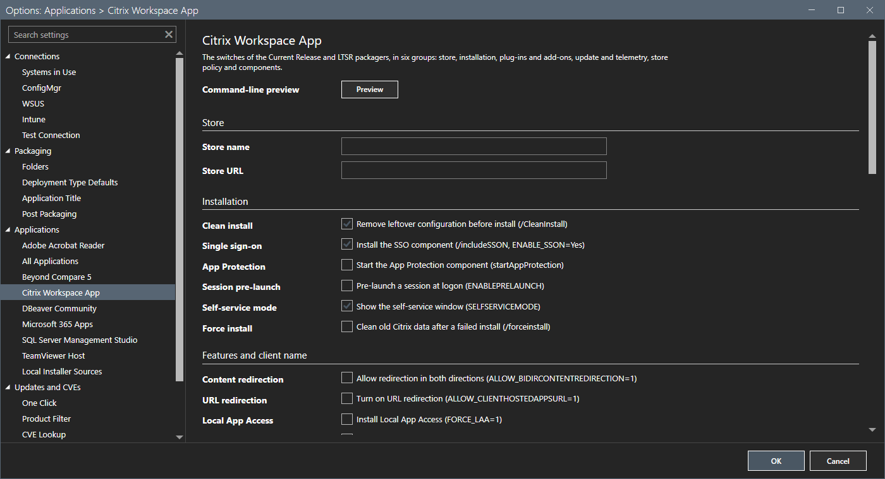

#### DBeaver Community

The install scope and the environment variable `DBEAVER_AI_DISABLED`.

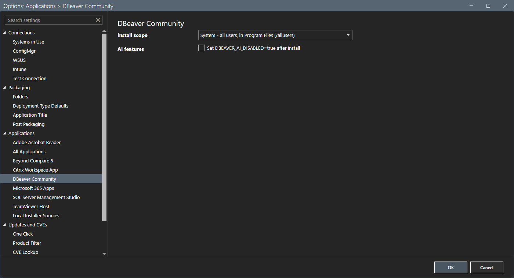

#### Microsoft 365 Apps

Links to the Office Deployment Tool download and the configuration.xml reference, **Import** and **Use my own configuration.xml**, and the generated settings. See the steps below.

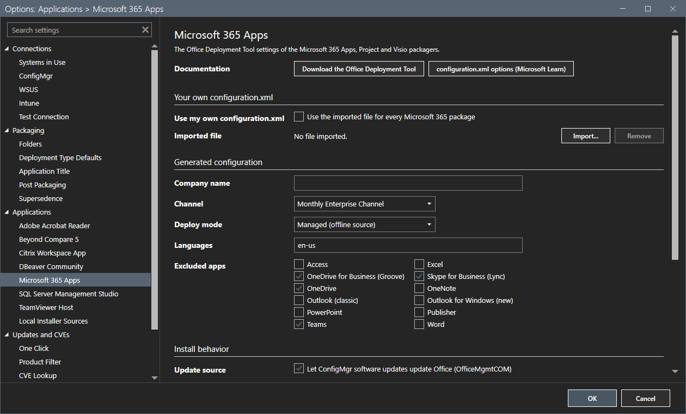

#### SQL Server Management Studio

The UI mode, the install path, the workloads, the languages and the other switches of the SSMS 22 setup.

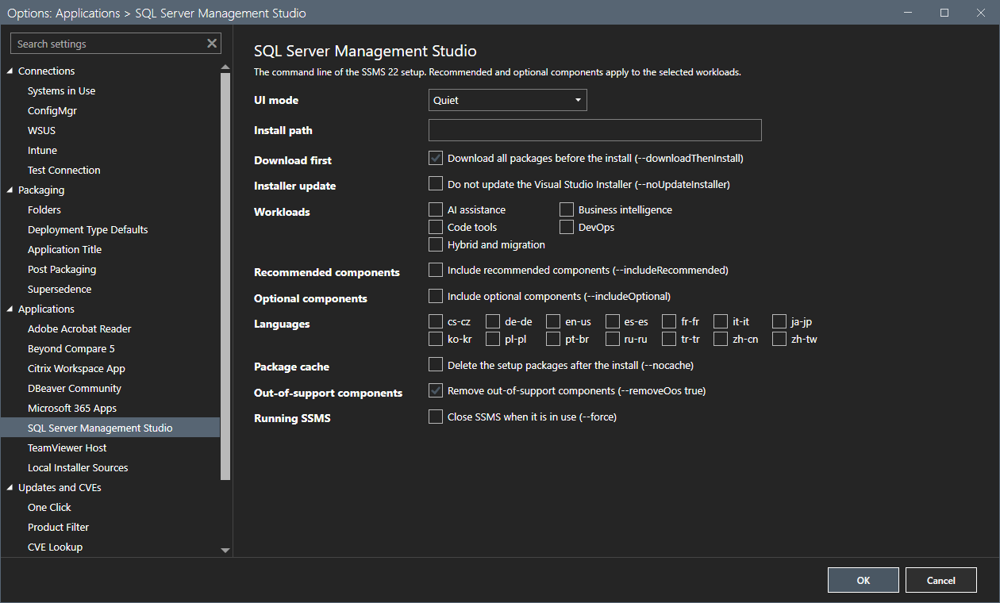

#### TeamViewer Host

The four settings of the TeamViewer Host MSI: API token (APITOKEN), Custom config ID (CUSTOMCONFIGID), Assignment options (ASSIGNMENTOPTIONS) and Desktop shortcut (DESKTOPSHORTCUTS=0). The packager installs the MSI that you put in the installer source folder of TeamViewer Host, and an empty value is not passed. The values are written to the install script of the package in clear text.

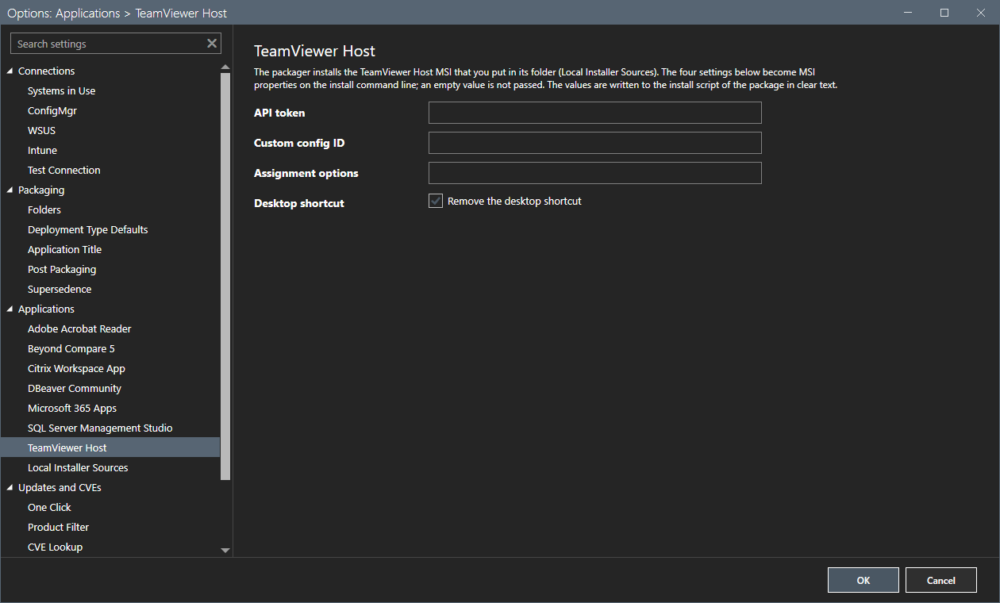

#### Local Installer Sources

One installer source folder for each packager whose installer a script cannot download: a vendor sign-in (Citrix Workspace, TeamViewer Host) or a bot protection (TortoiseSVN). You put the file in the folder by hand, and the packager reads the version from it. TeamViewer Host takes `TeamViewer_Host*.msi` (the Management Console download, unzipped), and TortoiseSVN takes `TortoiseSVN-*-x64-*.msi`. The caption names the packager file. See Installer source folders in the README.

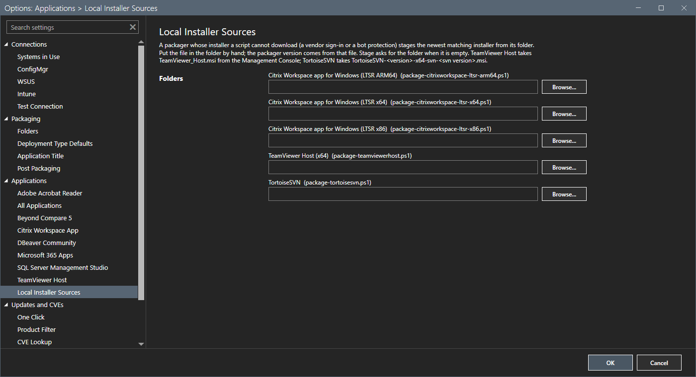

### Updates and CVEs

#### One Click

The action on an update, the default destinations, the policy for an existing ConfigMgr application, and for each application the Track box, its destinations and its cadence. See [One Click](one-click.md).

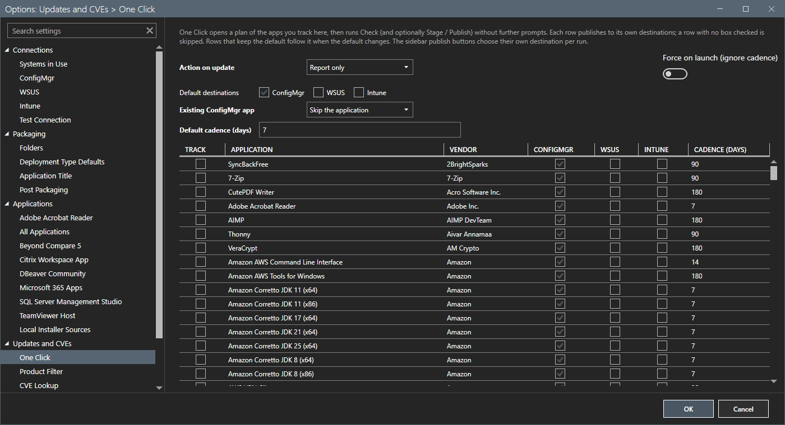

#### Product Filter

Shows or hides single packagers in the main grid, grouped by vendor. **Not offered by Discover** counts the applications that Discover leaves out, and **Clear List** empties the list.

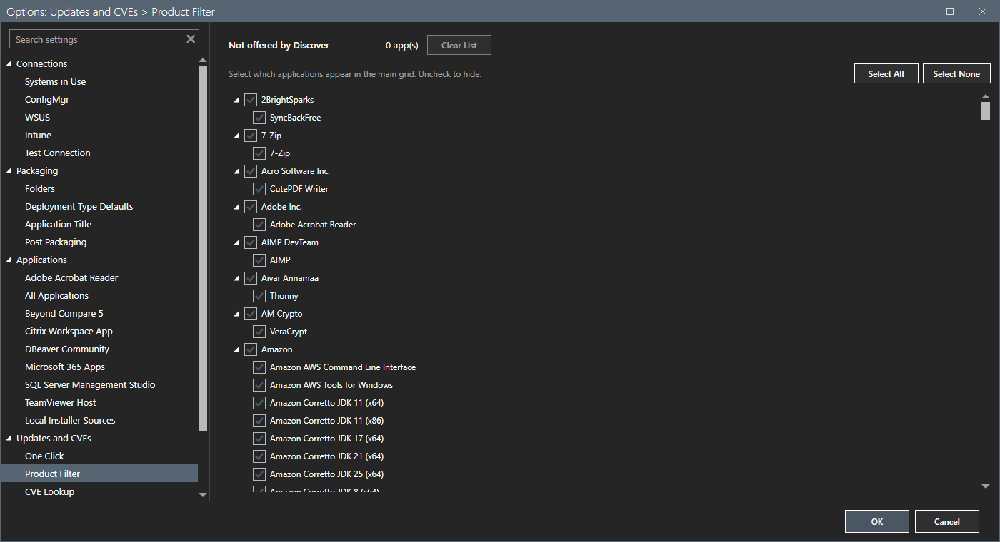

#### CVE Lookup

The **NVD API key**, the **Cache time** and **Automatic lookup**. See [Check CVEs](cve.md).

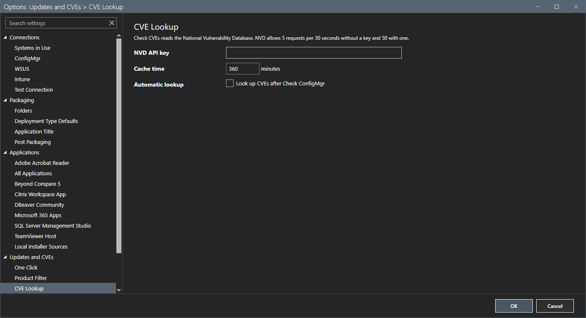

### Security

#### Script Signing

The Authenticode signing of the scripts that AppPackager stages: which kinds are signed, which signatures are required, the certificate store and the certificate, and the timestamp server. **Test signing configuration** signs and verifies a temporary file. A required signature that fails stops the build. There is no unsigned fallback.

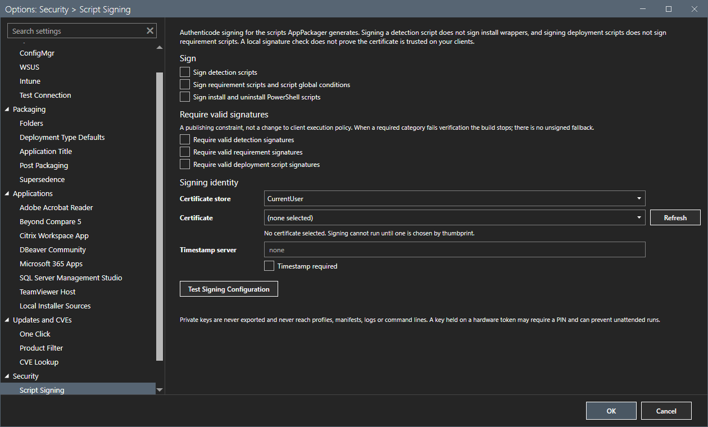

### Tools

#### Tools

The detected **Console**, **Content Prep Tool**, **7-Zip** and **Icon pack**. The values are read-only. The **Icon pack** line has two buttons: **Download** gets the latest icon pack from the `app-packager-icons` release, checks its SHA-256 and unpacks it into `Packagers\Icons`; **Install from file** does the same from a local or network `icon-pack.zip`. Download the pack once after the install and again after a new release of the pack, so that the grid shows the application icons.

**GitHub Authentication** shows how AppPackager signs in to the GitHub API and how many requests are left this hour. The optional **GitHub token** field stores a personal access token with DPAPI for the current Windows user. The order is the saved token, then `APP_PACKAGER_GITHUB_TOKEN`, `GITHUB_TOKEN`, `GH_TOKEN`, then the `gh` sign-in, so a token that you type here overrides the others. The **Status** line names the source in use, in the same words as App Packager Desktop: `Signed in via GitHub CLI as <account>`, `Token saved in settings as <account>`, `Environment variable GITHUB_TOKEN as <account>` or `Not authenticated: 60 requests per hour`. The note under the token box says which source provides the token and that a saved token wins. A token that GitHub refuses shows `Token rejected (401)`; the packagers do not fall back to anonymous calls. With a token the limit is 5000 requests per hour; without one it is 60. The app finds `gh.exe` on the PATH and, when the PATH of the process lacks it (a shortcut or the suite launcher started the app), in the Program Files, WinGet, scoop and Chocolatey folders.

### About

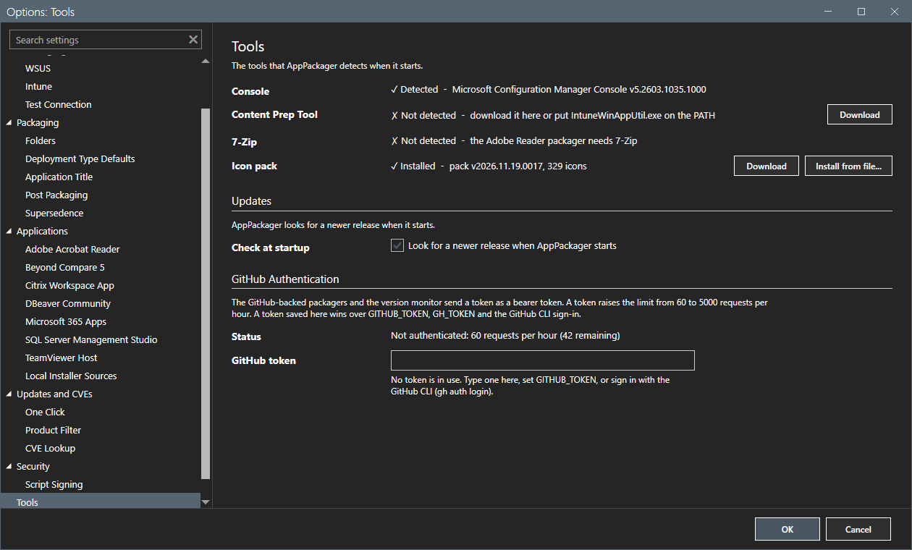

#### About

The name, the installed version, the license, the link to the repository, the time of the last update check and the latest known release. **Update Now** shows here when a newer release exists.

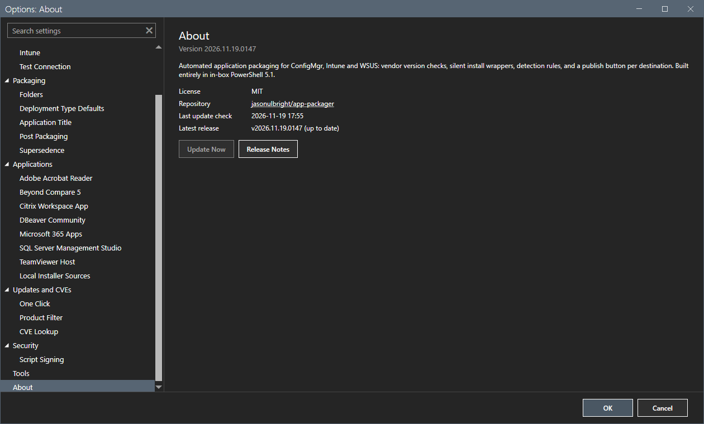

### Use your own Microsoft 365 configuration.xml

1. Open **Applications**, then **Microsoft 365 Apps**.
2. Select **Import** and choose your configuration.xml. The tool checks that the file is well-formed XML with a `Configuration` root and an `Add` element that has a `Product` with an `ID`. A file that fails the check is refused with the reason. The tool does not send the file anywhere.
3. Select **Use my own configuration.xml**. The Company name, Channel, Deploy mode, Languages, Excluded apps and install behavior settings are disabled. A line says why.
4. Select **OK**. The tool stores a copy in `Packagers\m365-configuration.user.xml`. The section shows the name and the size of the file. **Remove** deletes the copy.

The Microsoft 365 Apps, Project and Visio packagers use the file. They still set `OfficeClientEdition`, `Version`, `SourcePath` and a silent `Display`, keep the channel of the file, and keep their own detection. A file with a `SourcePath` stages in the Managed mode. A file without one stages in the Online mode. **Preview** shows the result.

### Light theme

The light theme gives the same dialog.

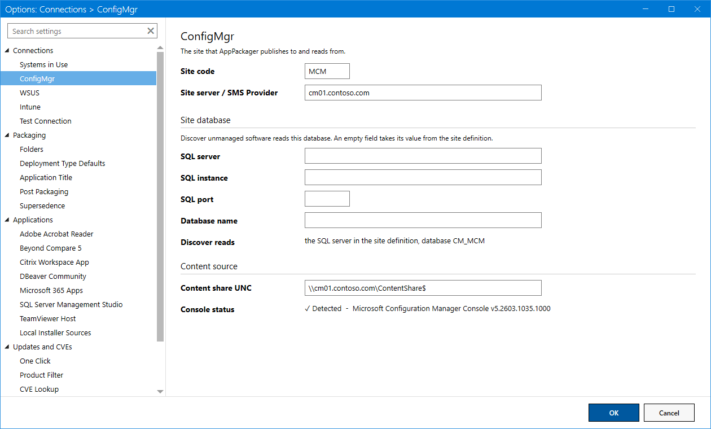

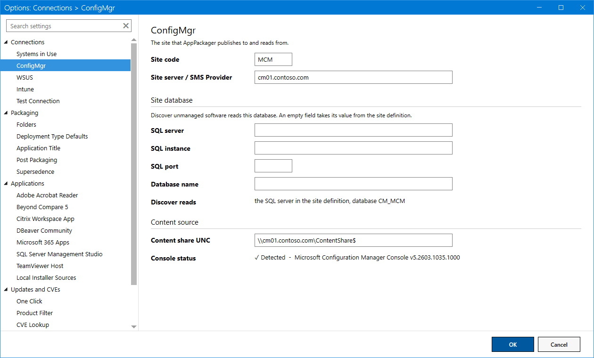

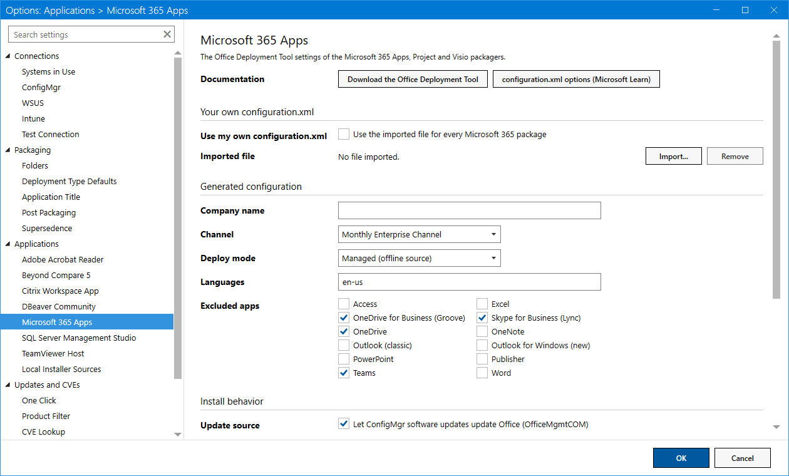

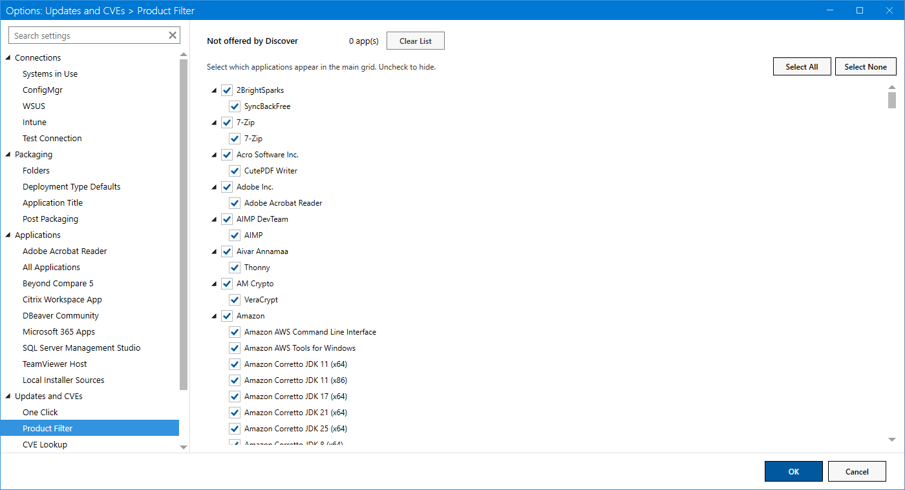

### Without the console

Without the console, the ConfigMgr section shows `Not detected` for it. The buttons that need the console are disabled.

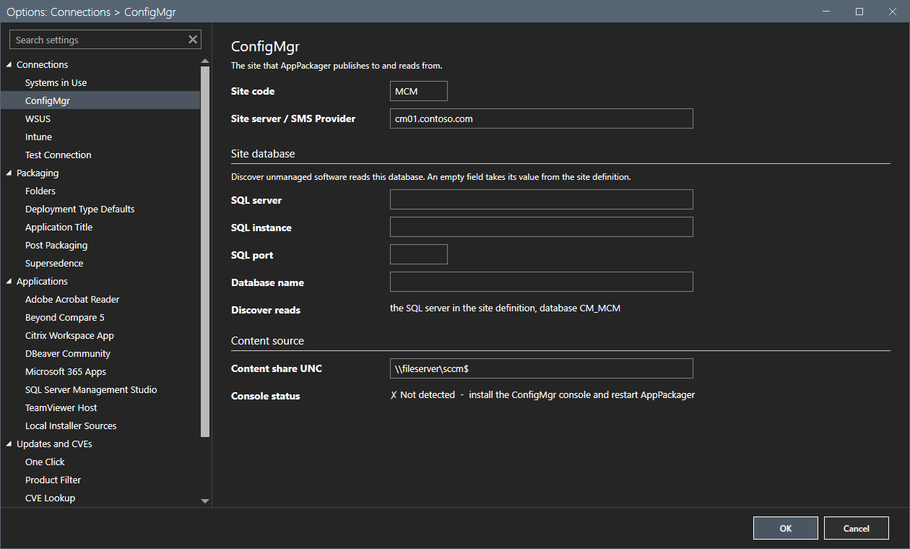

## Options and settings of this page

| Section | What it sets |
|---|---|
| Connections | Systems, ConfigMgr, WSUS, Intune and the connection tests. |
| Packaging | Folders, deployment type defaults, the title rule and the Post Packaging steps. |
| Applications | The grid of all applications, the install options of seven applications and the local installer sources. |
| Updates and CVEs | The tracked set and its destinations, the product filter and the CVE lookup. |
| Security | Authenticode signing of staged scripts. |
| Tools | The detected tools. |
| About | Version and update check. |

[Settings](../reference/settings.md) lists every key and the section that edits it. [Installer options audit](../reference/installer-options-audit.md) lists the vendor source of each switch.

## Limits

- The settings are saved in `AppPackager.preferences.json` in the install folder. Some packager values are copied to `Packagers\packager-preferences.json`.
- The Citrix Workspace App and TeamViewer Host settings are saved in their own files in `Packagers`.
- A scheduled version monitor has its own configuration file. See [Files and logs](../reference/files-and-logs.md).

## Troubleshooting

| Message or symptom | Cause | Fix |
|---|---|---|
| **Console** shows `Not detected`. | The console is not installed, or its module is not found. | Install the console, or set `SMS_ADMIN_UI_PATH` to its `bin\i386` folder. Start the tool again. |
| **GitHub Authentication** shows `Not authenticated`. | No token is set. | Type a **GitHub token** in Options, Tools, set `GITHUB_TOKEN` or `GH_TOKEN`, or run `gh auth login`. |
| A signing test fails. | No certificate is chosen, or the key needs a PIN. | Choose a certificate by thumbprint. |
| The save stops with a message about a port. | The port is not a whole number from 1 to 65535. | Correct the port. |
| The import of a configuration.xml fails. | The file is not well-formed XML, or it has no `Add` element with a `Product`. | Correct the file. The message names the reason. |

## Links

- [Getting started](../getting-started.md)
- [Settings](../reference/settings.md)
