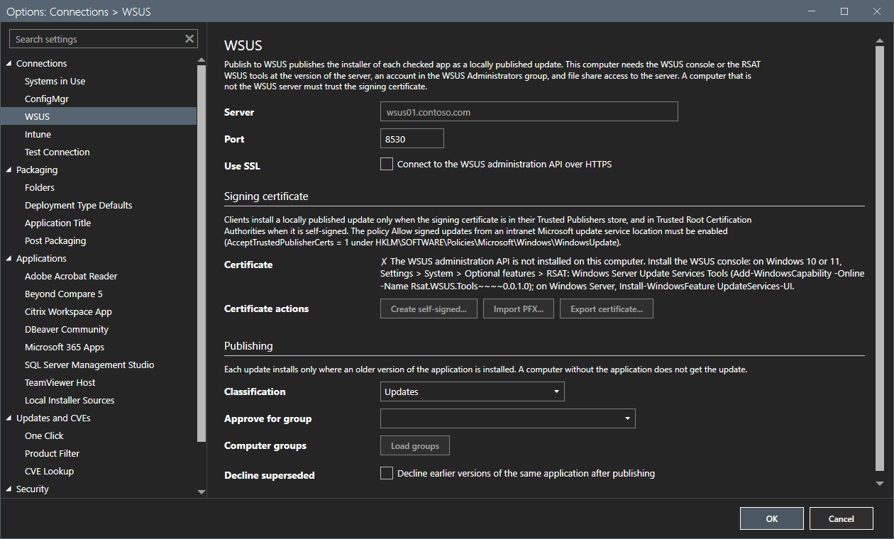

# Publish to Intune and Publish to WSUS

These two buttons send the checked applications to Intune or to a WSUS server. Neither needs the Configuration Manager console, a site or a file share.

## What it does

**Publish to Intune** stages each checked application, builds its `.intunewin` file and publishes it as a Win32 app through Microsoft Graph. **Publish to WSUS** stages each checked application and publishes its installer to WSUS as a locally published update. **WSUS Updates** lists the published updates and approves, declines, expires or removes them.

## When to use it

Use Publish to Intune to make the application available to Intune devices. Use Publish to WSUS to update an application that is already installed on computers that take their updates from WSUS.

## Requirements

- Intune: an Entra app registration with the permission `DeviceManagementApps.ReadWrite.All`. The tenant ID, the client ID and the client secret go in **Options**.
- WSUS: the WSUS console at the version of the server, an account in the WSUS Administrators group, network access to the API port of the server (8530, or 8531 with SSL), and a signing certificate that the computer and the clients trust.
- The system is turned on under **Systems in Use**, in Setup or in Options.

This guide did not connect to Intune or to a WSUS server. Everything on this page comes from the README and the code. It was not checked on a live tenant or server.

## Steps

### Turn the systems on

1. Select **Options**.
2. Under **Connections**, on **Systems in use**, select **Intune**, **WSUS** or both.
3. For Intune, open **Intune** and type the tenant ID, the client ID and the client secret. For WSUS, open **WSUS** and type the server. **Test connection** checks each system.

A button of a system that is not ready stays disabled. Its tooltip says what is missing.

### Publish to Intune

1. Check the rows and select **Publish to Intune**.
2. The tool stages each application, builds the `.intunewin` file, and creates the Win32 app in Intune. The app is created without an assignment.

### Publish to WSUS

1. Check the rows and select **Publish to WSUS**.
2. The tool checks the manifest, verifies the payload against the hashes that Stage recorded, builds the update, maps the detection to applicability rules and publishes the update.
3. A row that WSUS cannot carry shows **WSUS: not supported**, and the log names the reason.

WSUS offers an update only to a computer where the detection finds the application with an older version. A computer without the application never gets the update. Use a Configuration Manager or Intune deployment for a first installation.

### Manage the WSUS updates

Select **WSUS Updates**. The window lists the updates that AppPackager published. You can **Approve for Group**, **Decline**, **Expire** and **Remove** the selected updates. **Expire** and **Remove** cannot be undone.

## Options and settings of this page

| Setting | Effect |
|---|---|
| WSUS server, Port, Use SSL | The API endpoint of the server. |
| Classification | The WSUS classification of every published update. |
| Approve for Group | Approves each new update for this group. |
| Decline earlier versions | Declines the earlier versions of the same application. |
| Signing certificate buttons | **Create Self-Signed**, **Import PFX** and **Export Certificate** manage the WSUS signing certificate. |

## Limits

- Intune publishing uses Microsoft Graph v1.0. The Graph property for the maximum run time does not exist, so the tool records it in the manifest only.
- A payload larger than 2047 MB, a per-user or interactive install, an MSIX or Office Deployment Tool package, a variant set and a custom install script are not supported for WSUS.
- A patched WSUS server is needed before you expose its ports. See the Microsoft security guidance for CVE-2025-59287.

## Troubleshooting

| Message or symptom | Cause | Fix |
|---|---|---|
| The publish button is disabled. | The system is not in use, or a setting is missing. | Hover over the button. Set the value in Options. |
| A row shows `WSUS: not supported`. | The application cannot be carried by WSUS. | Read the reason in the log. Use ConfigMgr or Intune. |
| A row shows `Published, warning`. | The approval or the decline failed after the publish. | Read the log. Approve in **WSUS Updates**. |

## Links

- [Options dialog](options.md)
- [Network](../reference/network.md)
