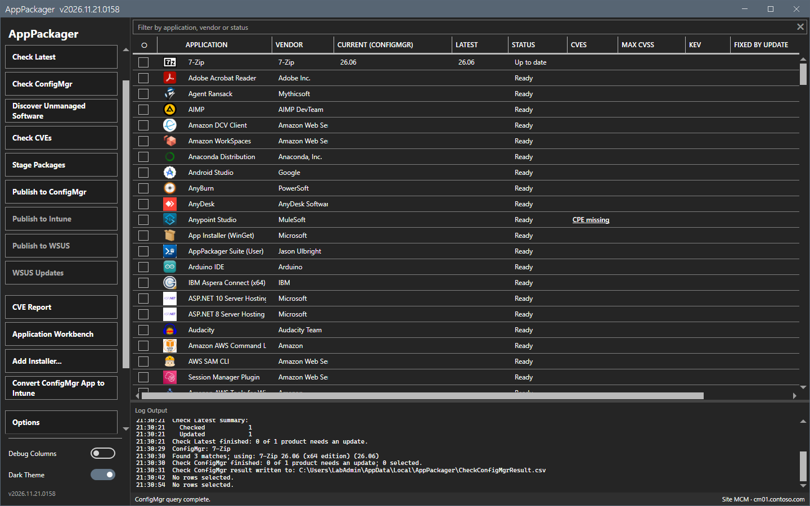
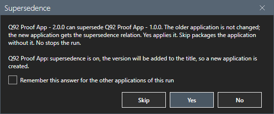
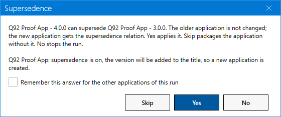

# Stage and Publish to ConfigMgr

Stage builds the content of an application in a local folder. Publish to ConfigMgr copies that content to the share and creates the application on the site.

## What it does

**Stage Packages** runs the packager script of each checked row with `-StageOnly`. The script downloads the installer from the vendor, checks it, reads its metadata, writes the install and uninstall scripts and the detection rule, and writes a `stage-manifest.json`. **Publish to ConfigMgr** reads that manifest, copies the content to a versioned folder on the content share and creates the Configuration Manager application with its deployment type and detection method.

## When to use it

Use Stage to build and inspect the content before it goes anywhere. Use Publish to ConfigMgr when the staged content is right.

## Requirements

- Stage: a **Download Root** folder that you can write to, and access to the vendor site.
- Publish to ConfigMgr: the console on this computer, a site code, write access to the **File Share Root**, and the right to create applications. See [Permissions](../reference/permissions.md).

## Steps

### Stage an application

1. Check the row of the application.
2. Select **Stage Packages**. The status bar and the progress overlay show the work.


3. Wait for the status `Complete.` The row status changes to `Staged`. The log shows the log file of the stage, for example `Staged. Logs: package-7zip-stage-<date>-<time>.out.log`.


The content is in the **Download Root**, in one folder for each application and version:

```
<Download Root>\<App>\<Version>\
    installer.msi (or .exe)
    install.bat, install.ps1, uninstall.bat, uninstall.ps1
    stage-manifest.json
```

When the tool finds `IntuneWinAppUtil.exe`, Stage also builds a `.intunewin` file beside the content.

### Publish to ConfigMgr

1. Check the rows. Each row must be staged. A row that is not staged is staged first.
2. Select **Publish to ConfigMgr**. The tool checks that the **File Share Root** is reachable, copies the content and creates the application.
3. If the site already has an application with the same title, a dialog asks: **Overwrite**, **Skip** or **Cancel Run**. Overwrite replaces the deployment types and keeps the application and its deployments.

When the share cannot be reached, the run stops before it copies anything and before it changes the site. The row status shows `Package error` and the log names the path. This guide used a share that does not exist, on purpose, so it created no application.



This guide did not run a publish to a real share. A successful publish was not checked.

### Supersedence

A new version can supersede the older application. This is a setting of the application, and it is off until you turn it on in Options, Packaging, Supersedence. The application then keeps the version in its name, so each release is its own application. At **Publish to ConfigMgr** the tool looks for the older application with the same title and the same vendor, takes the highest version below the new one, and asks first:

1. **Yes** applies the supersedence: the new application supersedes the older one, one relation for each pair of deployment types. The older application is not changed.
2. **Skip** packages the application without the supersedence.
3. **No** stops the run.





**Remember this answer** applies the answer to the other applications of the run. The dialog also names an application whose title has no version yet: the version is added, so a new application is created. Only the highest older version is superseded, never a lower one: when that application is retired, or the new application names no vendor, the tool finds no older version. When the tool finds no older version, the log says so and nothing is asked. The tool does not rewrite the detection of applications that it published earlier, and it does not mark applications. An application that an earlier release marked keeps its keywords. See [Options](options.md) for the setting by application and the command line option `-SupersedenceAnswer`.

#### Supersedence in Intune

The same setting applies to **Publish to Intune**. After the Win32 app is published, and when you answered **Yes**, the tool looks for the older app with the same display name and the same publisher, takes the highest version below the new one, and creates one supersedence relation from the new app to it. Other titles and older versions are not changed. The version rule for Intune in Options sets the detection of the new app. In an unattended run the answer is **Skip**, with one line in the log.

The relation is the only Microsoft Graph beta call of the tool. Microsoft Graph v1.0 has no resource for app relationships, so the tool reads the relations of the new app and writes them with the beta endpoint `updateRelationships`. Every other call uses v1.0. Microsoft can change a beta endpoint without notice. The write was not proven against a tenant: it is tested with a simulated Graph only. The write replaces all relations of the app, so the tool sends the dependencies and the supersedences that the app already has again.

If the relation fails, the Intune app stays published, the log and the result say that the relation was not created and why, and you can add the relation in the Intune admin center. Intune does not assign the new app: assign it yourself, because a superseding app that has no assignment is ignored on the devices.

## Options and settings of this page

| Setting | Effect |
|---|---|
| Site code, Site server / SMS Provider (Options > Connections > ConfigMgr) | The site that receives the application. |
| Content share UNC (Options > Connections > ConfigMgr), Content layout (Options > Packaging > Folders) | The share and the folder shape of the content: **Nested** or flat. |
| Download root (Options > Packaging > Folders) | The local folder of Stage. |
| Estimated runtime, Maximum runtime (Options > Packaging > Deployment Type Defaults) | The runtime values of the deployment type. |
| Fallback distribution points, Neighbor/default DP (Options > Packaging > Deployment Type Defaults) | The content options of the deployment type. |
| Distribute content, DP group, Test deployment, Test collection (Options > Packaging > Post Packaging) | Distribute the content to a distribution point group after Package, and deploy to a test collection after the distribution. |
| Include version, Remove version (Options > Packaging > Application Title) | The title rule of the application. |

## Limits

- Stage needs no site and no share. Publish does.
- A failed application does not stop the next application of the run.
- Publish never signs scripts on its own. The signing policy of [Options dialog](options.md) decides.

## Troubleshooting

| Message or symptom | Cause | Fix |
|---|---|---|
| The log says `Network root path not accessible: <path>`. | The content share does not exist or you have no access. | Correct the path in **Options > Connections > ConfigMgr**. Check the rights. |
| Stage ends with `Failed`. | The download failed, or the vendor changed the page. | Open the log file that the log line names. |
| A dialog asks about an existing application. | The title exists on the site. | Choose Overwrite, Skip or Cancel Run. |

## Links

- [Check Latest and Check ConfigMgr](versions.md)
- [Publish to Intune and Publish to WSUS](publish-intune-wsus.md)
