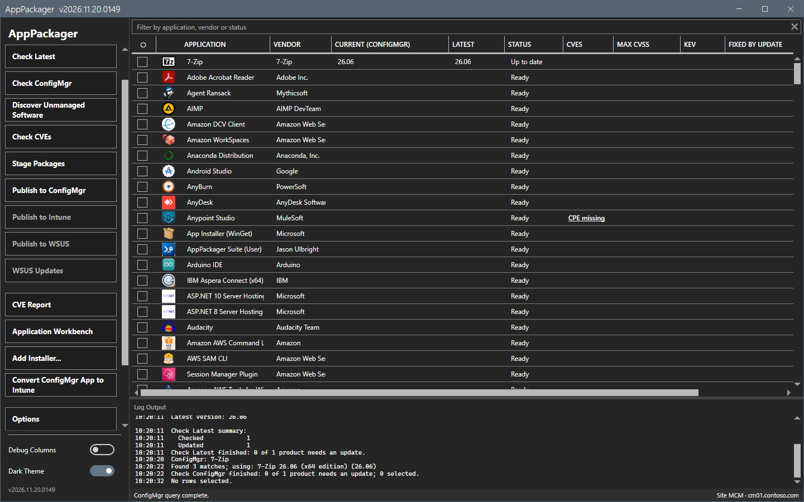

# Stage and Publish to ConfigMgr

Stage builds the content of an application in a local folder. Publish to ConfigMgr copies that content to the share and creates the application on the site.

## What it does

**Stage Packages** runs the packager script of each checked row with `-StageOnly`. The script downloads the installer from the vendor, checks it, reads its metadata, writes the install and uninstall scripts and the detection rule, and writes a `stage-manifest.json`. **Publish to ConfigMgr** reads that manifest, copies the content to a versioned folder on the content share and creates the Configuration Manager application with its deployment type and detection method.

## When to use it

Use Stage to build and inspect the content before it goes anywhere. Use Publish to ConfigMgr when the staged content is right.

## Requirements

- Stage: a **Download Root** folder that you can write to, and access to the vendor site.
- Publish to ConfigMgr: the console on this computer, a site code, write access to the **File Share Root**, and the right to create applications. See [Permissions](../reference/permissions.md).

## Steps

### Stage an application

1. Check the row of the application.
2. Select **Stage Packages**. The status bar and the progress overlay show the work.



3. Wait for the status `Complete.` The row status changes to `Staged`. The log shows the log file of the stage, for example `Staged. Logs: package-7zip-stage-<date>-<time>.out.log`.


The content is in the **Download Root**, in one folder for each application and version:

```
<Download Root>\<App>\<Version>\
    installer.msi (or .exe)
    install.bat, install.ps1, uninstall.bat, uninstall.ps1
    stage-manifest.json
```

When the tool finds `IntuneWinAppUtil.exe`, Stage also builds a `.intunewin` file beside the content.

### Publish to ConfigMgr

1. Check the rows. Each row must be staged. A row that is not staged is staged first.
2. Select **Publish to ConfigMgr**. The tool checks that the **File Share Root** is reachable, copies the content and creates the application.
3. If the site already has an application with the same title, a dialog asks: **Overwrite**, **Skip** or **Cancel Run**. Overwrite replaces the deployment types and keeps the application and its deployments.

When the share cannot be reached, the run stops before it copies anything and before it changes the site. The row status shows `Package error` and the log names the path. This guide used a share that does not exist, on purpose, so it created no application.


This guide did not run a publish to a real share. A successful publish was not checked.

### Rewrite old versions

A new version can supersede an older application. For the old application to uninstall cleanly, its detection must stop finding the application once it is removed. A `GreaterEquals` clause still finds the new version, so the uninstall registers as failed. **Rewrite Old Versions** changes that clause to `IsEquals` for the older applications of one product line.

1. Check one application.
2. Select **Rewrite Old Versions**. The tool reads the product line from the site. The dialog lists each clause that it changes, the applications that it blocks (an application with a required deployment) and the clauses that it leaves, with the reason.
3. Read the notes. A device that has a newer version than the one in the clause then reads "not installed".
4. Check the confirmation box and select **Rewrite N Clauses**. The tool reads the site again and writes only when the clauses are the ones that the dialog showed. Each clause is written to the log first.
5. Read the result. Select **Undo** to write the old operator back.

**Restore Old Versions** does the second part alone, for a rewrite of an earlier session: it lists the rewrites of this line that the log holds and no restore cancels. The log is `supersedence-rewrite.jsonl` in the Workbench data folder. The buttons are disabled for the reasons of **Publish to ConfigMgr**: ConfigMgr is not in use, the console is missing or the site code is empty. See [Command line](../reference/command-line.md) for the same steps without the window.

## Options and settings of this page

| Setting | Effect |
|---|---|
| Site code, Site server / SMS Provider (Options > Connections > ConfigMgr) | The site that receives the application. |
| Content share UNC (Options > Connections > ConfigMgr), Content layout (Options > Packaging > Folders) | The share and the folder shape of the content: **Nested** or flat. |
| Download root (Options > Packaging > Folders) | The local folder of Stage. |
| Estimated runtime, Maximum runtime (Options > Packaging > Deployment Type Defaults) | The runtime values of the deployment type. |
| Fallback distribution points, Neighbor/default DP (Options > Packaging > Deployment Type Defaults) | The content options of the deployment type. |
| Distribute content, DP group, Test deployment, Test collection (Options > Packaging > Post Packaging) | Distribute the content to a distribution point group after Package, and deploy to a test collection after the distribution. |
| Include version, Remove version (Options > Packaging > Application Title) | The title rule of the application. |

## Limits

- Stage needs no site and no share. Publish does.
- A failed application does not stop the next application of the run.
- Publish never signs scripts on its own. The signing policy of [Options dialog](options.md) decides.

## Troubleshooting

| Message or symptom | Cause | Fix |
|---|---|---|
| The log says `Network root path not accessible: <path>`. | The content share does not exist or you have no access. | Correct the path in **Options > Connections > ConfigMgr**. Check the rights. |
| Stage ends with `Failed`. | The download failed, or the vendor changed the page. | Open the log file that the log line names. |
| A dialog asks about an existing application. | The title exists on the site. | Choose Overwrite, Skip or Cancel Run. |

## Links

- [Check Latest and Check ConfigMgr](versions.md)
- [Publish to Intune and Publish to WSUS](publish-intune-wsus.md)
