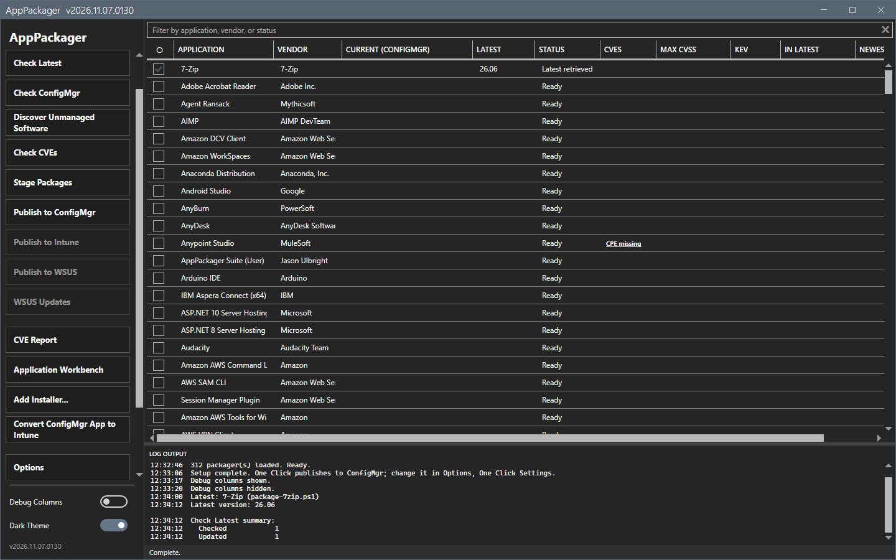
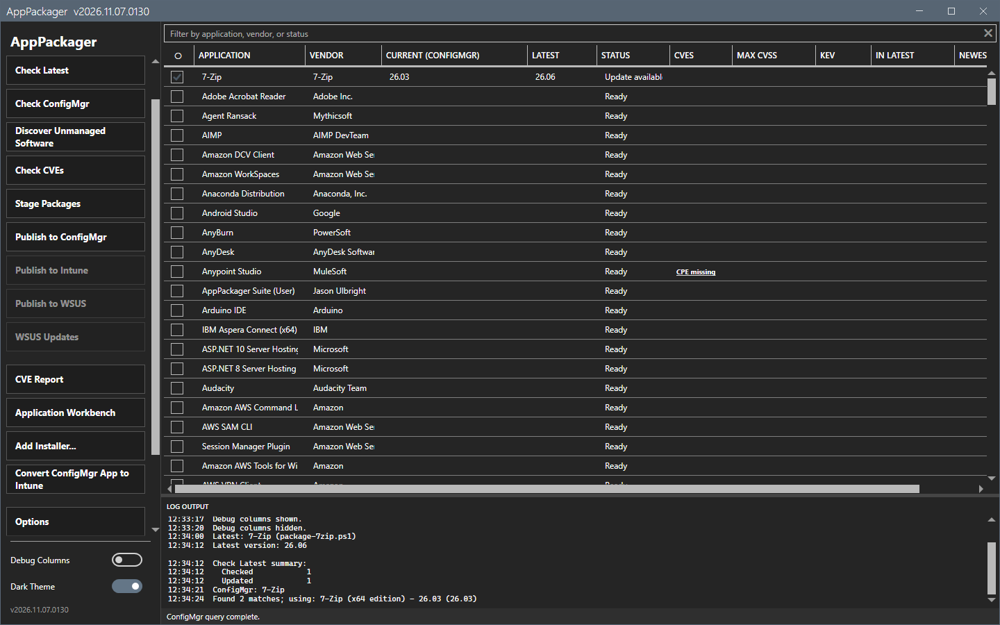
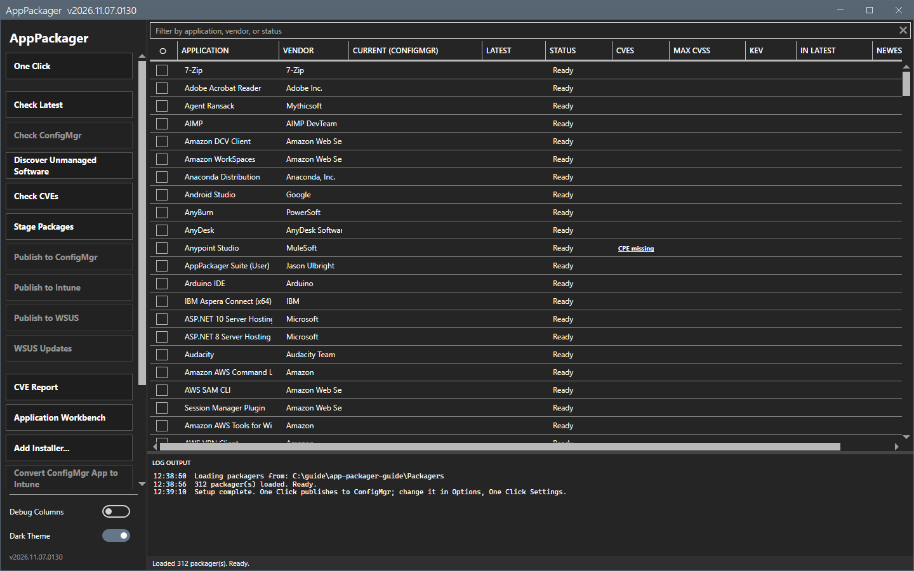
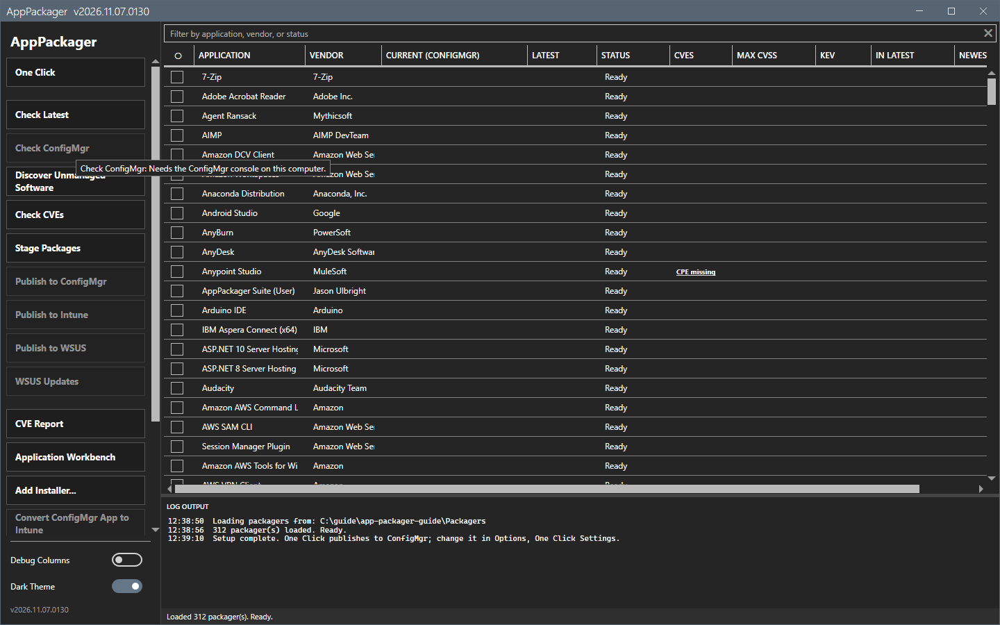
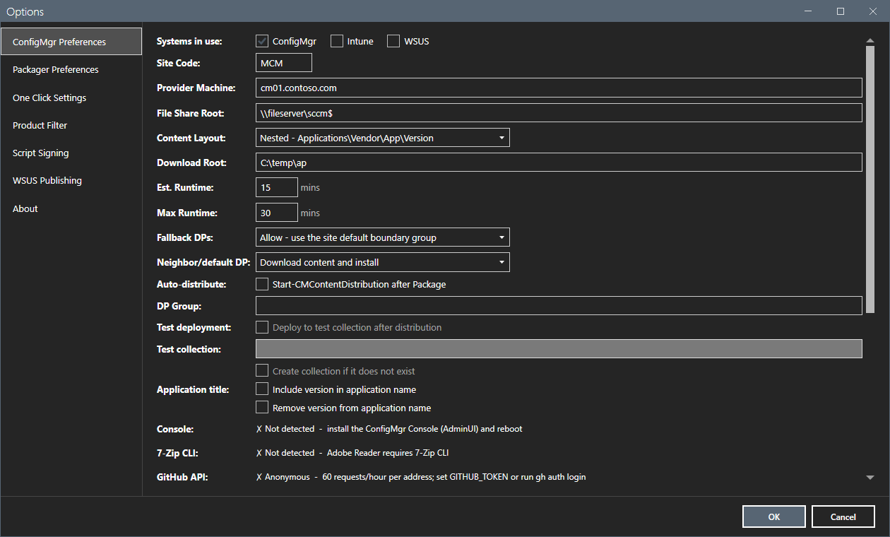

# Check Latest and Check ConfigMgr

Check Latest reads the newest version from the vendor. Check ConfigMgr reads the version that your site has. Together they show which applications need an update.

## What it does

**Check Latest** starts the packager script of each checked row with `-GetLatestVersionOnly`. The script asks the vendor site, or the GitHub release list, for the newest version. It downloads no installer. **Check ConfigMgr** queries the site for the application of each checked row and shows its version.

## When to use it

Use them before you stage, to see the current version and the latest version side by side.

## Requirements

- Check Latest: access to the vendor sites and to `api.github.com`. See [Network](../reference/network.md).
- Check ConfigMgr: the Configuration Manager console on this computer, a site code and a provider. The tool reads the site through the console module. It changes nothing on the site.

## Steps

### Check the latest version

1. Check one or more rows.
2. Select **Check Latest**. A progress overlay shows while the packagers run.

3. Wait for the status `Complete.` The **Latest** column shows the version, for example `26.06`. The log shows a summary with the number of checked and updated rows.

### Check the version on the site

1. Check the rows.
2. Select **Check ConfigMgr**.

3. Wait for the status `ConfigMgr query complete.` The **Current (ConfigMgr)** column shows the version of the application that the site has. When the site has more than one match, the log names the one that the tool uses: `Found 2 matches; using: 7-Zip (x64 edition) - 26.03 (26.03)`.

The first Check ConfigMgr can offer to hide the applications that the site does not have. Answer in the dialog.

### If the console is missing

On a computer without the console, the tool turns off **Check ConfigMgr**, **Publish to ConfigMgr** and **Convert ConfigMgr App to Intune**.

Hover over a disabled button to read the reason.

The Options dialog shows the console as not detected.

## Options and settings of this page

| Setting | Effect |
|---|---|
| **GitHub API** row in Options | Shows whether the GitHub calls carry a token. Without a token, GitHub allows 60 calls for each hour and address. |
| **Look up CVEs after Check ConfigMgr** | Starts Check CVEs for the same rows after Check ConfigMgr. See [Check CVEs](cve.md). |

## Limits

- A title with other words, or another installer method or architecture, does not count as the same application. Check ConfigMgr uses the exact title rule of the packager.
- Check Latest asks the vendor for each row. A vendor that blocks automated requests gives an error for that row only.

## Troubleshooting

| Message or symptom | Cause | Fix |
|---|---|---|
| **Check ConfigMgr** is disabled. | The console is not found on this computer. | Install the console. Set `SMS_ADMIN_UI_PATH` to its `bin\i386` folder if it is installed in a custom path. |
| The latest version stays empty. | The vendor site did not answer, or GitHub refused the anonymous calls. | Read the log. Set `GITHUB_TOKEN` or run `gh auth login`. |

## Links

- [Stage and Publish to ConfigMgr](stage-publish.md)
- [Check CVEs](cve.md)
