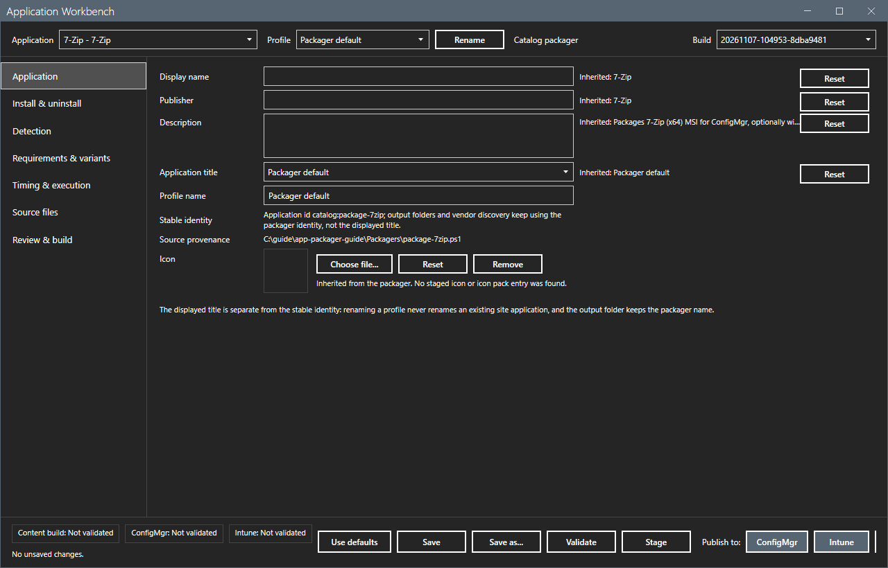
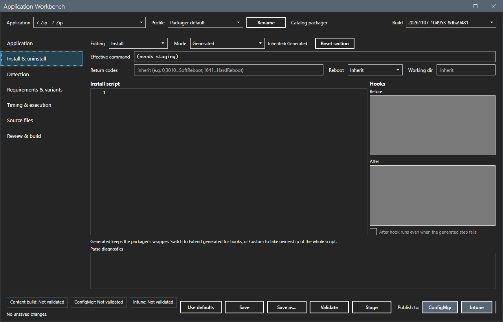
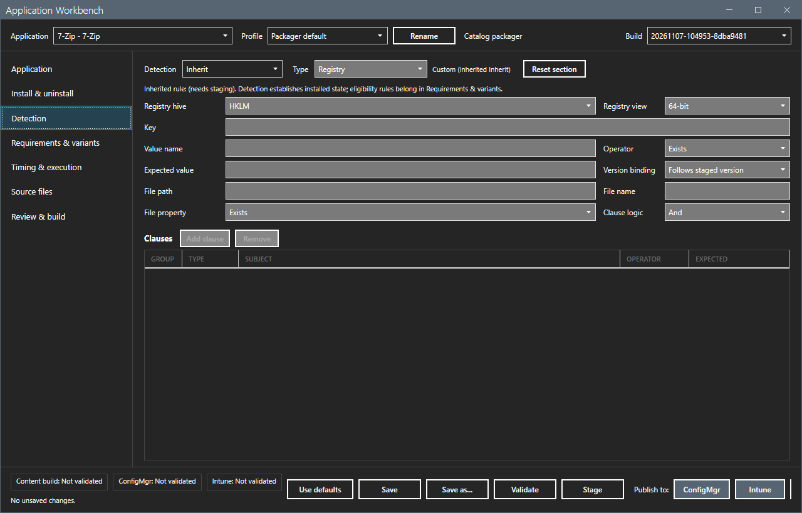
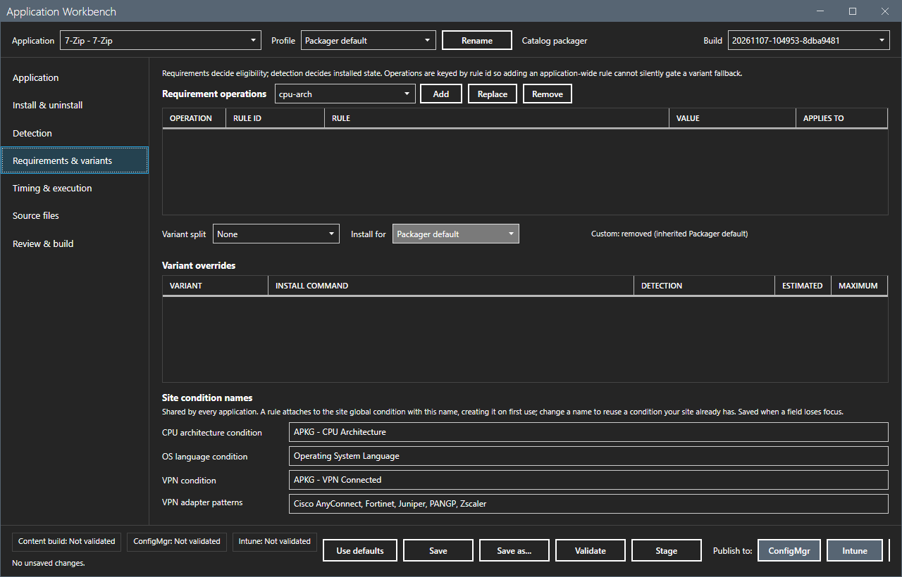
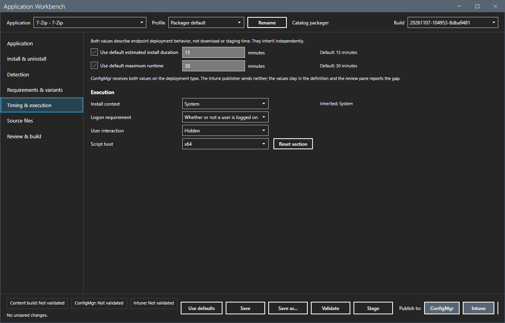
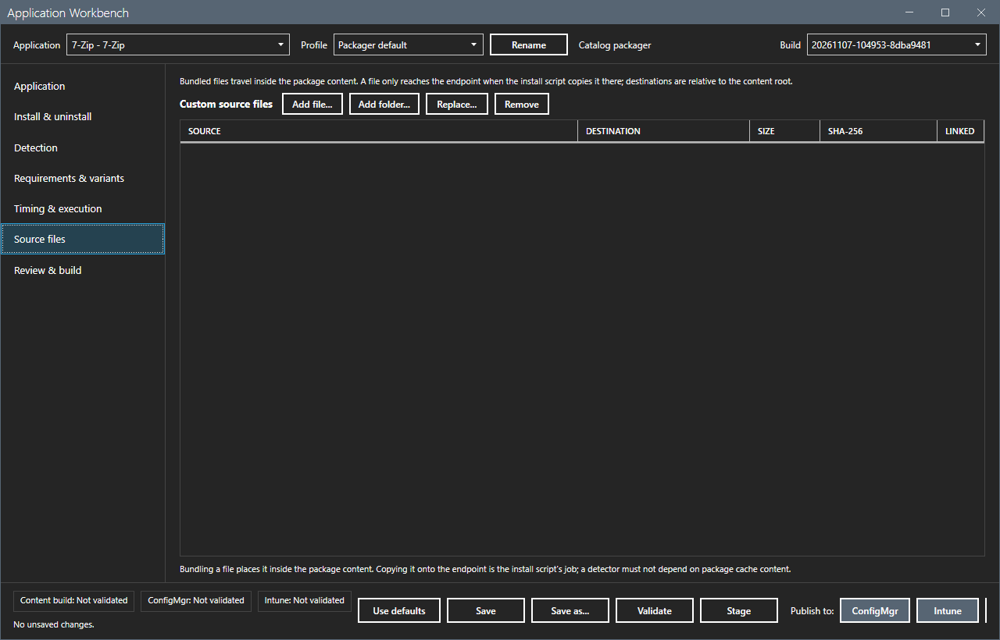
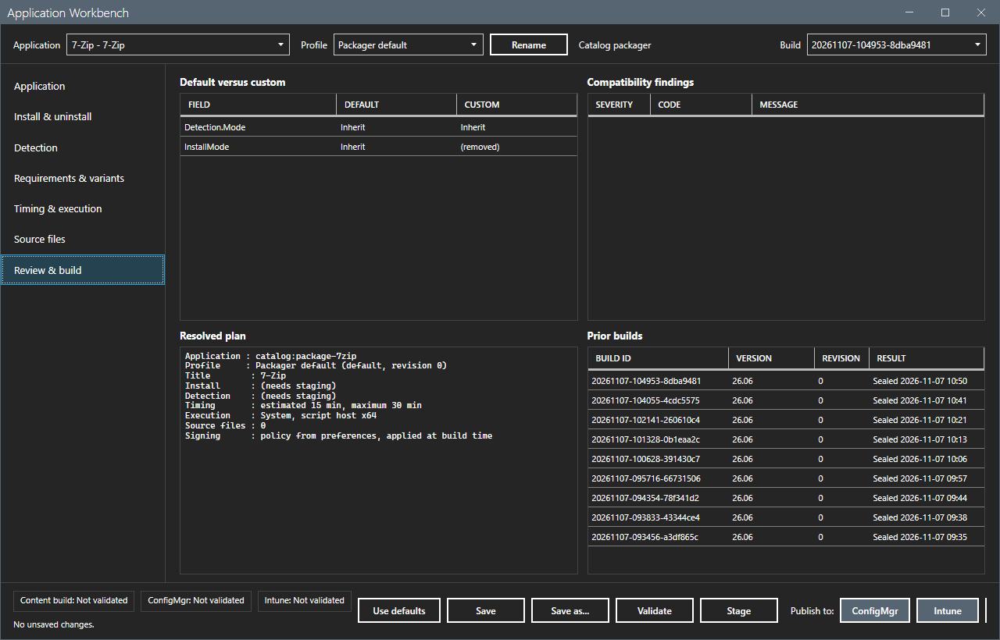

# Application Workbench

The Application Workbench changes how one application is built, without editing its packager script.

## What it does

Every field shows the value of the packager as inherited. When you change a field, it becomes a custom value with its own reset button. You save the changes in a named profile for the application. The Workbench also shows the findings for ConfigMgr and Intune before you build.

## When to use it

Use it to change the install command, the detection rule, the requirements, the runtime, the icon or the source files of one application, and to keep the change when the tool updates.

## Requirements

- A packager in the grid. The Workbench opens on the checked row.
- Nothing else. The Workbench sends nothing over the network. Its Stage and Publish buttons run the same packager and the same Package phase as the main window.

## Steps

### Open the Workbench

Select **Application Workbench**. A separate window opens. Select an application and a profile in the top bar. The **Build** list shows the builds of the application.

The **Application** page sets the display name, the publisher, the description, the application title rule, the profile name and the icon. The tool shows the stable identity and the source of the packager. The displayed title never renames an existing site application.

### Go through the pages

1. **Install & uninstall**: the install and uninstall command lines against the shipped defaults. You can keep the command, add scripts before and after it, or replace it.

2. **Detection**: the detection rule.

3. **Requirements & variants**: the requirement rules and the variant split, where the packager supports them.

4. **Timing & execution**: the estimated and the maximum runtime and the install context.

5. **Source files**: extra files for the content.

6. **Review & build**: the findings for ConfigMgr and Intune before the build.

### Save, validate and build

The buttons at the bottom are **Use defaults**, **Save**, **Save as...**, **Validate** and **Stage**. **Save** updates the active profile. **Save as...** copies it under a new name. The profile `default` is the packager as shipped. After **Validate**, the three status boxes show the result for the content build, for ConfigMgr and for Intune. **Publish to** sends the build to ConfigMgr or to Intune.

This guide opened and read the pages. It did not save a profile and did not select a Publish button of the Workbench.

## Options and settings of this page

| Control | Effect |
|---|---|
| Application, Profile, Build | Pick what the window shows. |
| Reset (each field) | Returns a field to the inherited value. |
| **Use defaults** | Returns the profile to the packager defaults. |
| **Save**, **Save as...** | Keep the changes in a profile. |
| **Validate** | Checks the profile. |
| **Stage** | Builds the content. |
| **Publish to** | Publishes the build to ConfigMgr or Intune. |

## Limits

- Profiles live in `%LOCALAPPDATA%\AppPackagerData\Workbench`, outside the install folder, so an update never touches them.
- One Click rebuilds an application when its vendor version, its profile or the signing policy changes.
- A profile change never renames an existing application on the site.

## Troubleshooting

| Message or symptom | Cause | Fix |
|---|---|---|
| The window opens slowly. | The Workbench reads the packagers and the builds. | Wait. It opened in less than two minutes in the lab. |
| The **Intune** button is disabled. | Intune is not in use or not set up. | See [Publish to Intune and Publish to WSUS](publish-intune-wsus.md). |

## Links

- [Command line](../reference/command-line.md)
- [Stage and Publish to ConfigMgr](stage-publish.md)
