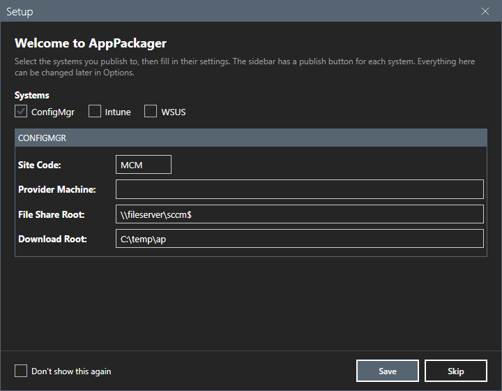
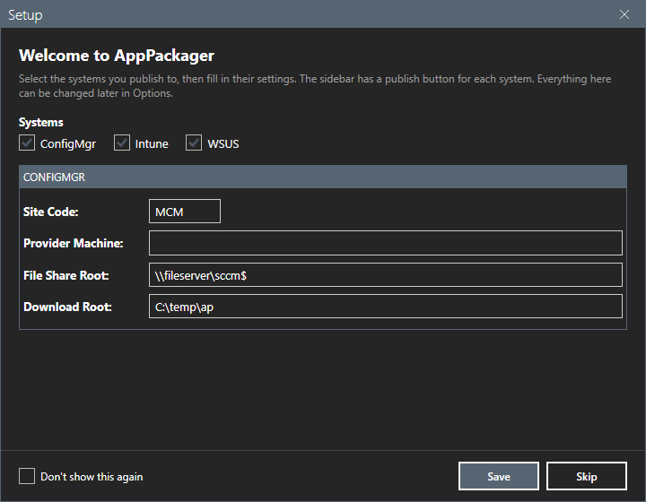
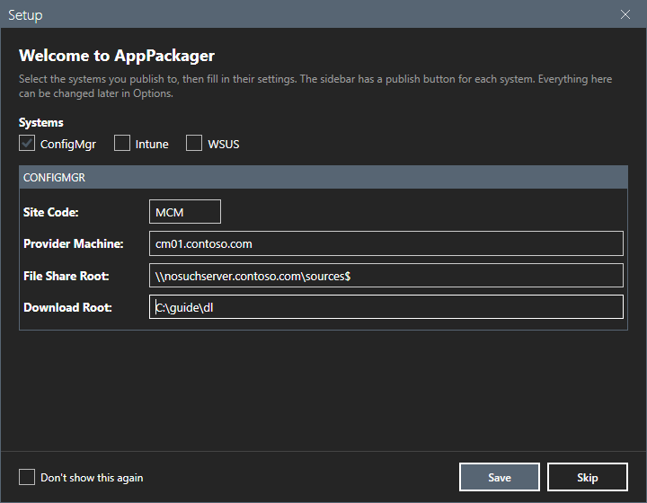
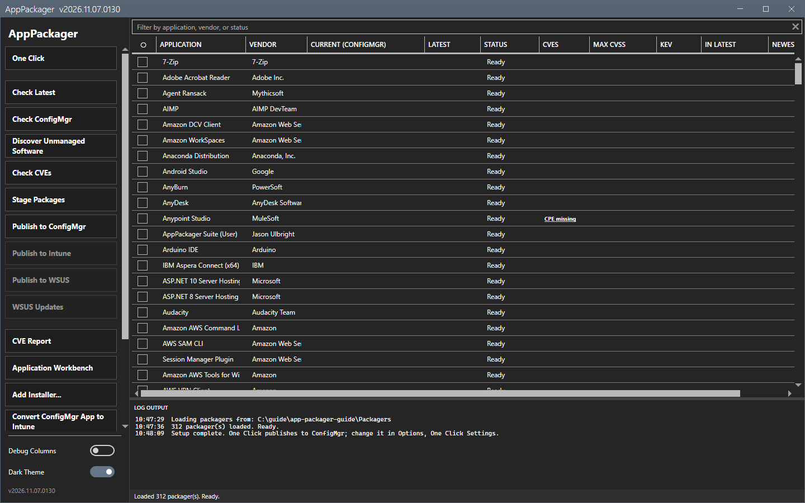

# Getting started

This page shows how to install AppPackager, answer the Setup window and find your way in the main window.

## What it does

AppPackager works in two phases. **Stage** downloads the installer from the vendor, reads its metadata, writes the install and uninstall scripts and a manifest, all in a local folder. **Package** copies the content to a share and creates the Configuration Manager application, or builds an `.intunewin` for Intune, or publishes the installer to WSUS.

## When to use it

Use it when you must keep many applications current in Configuration Manager, Intune or WSUS, and you want one repeatable way to build them.

## Requirements

- Windows 10 or Windows 11, or Windows Server 2016 or later. Windows PowerShell 5.1 and .NET Framework 4.7.2 or later.
- Local administrator rights, to run the packager scripts.
- For Check ConfigMgr, Publish to ConfigMgr and Convert ConfigMgr App to Intune: the Configuration Manager console on the same computer. The tool finds the `ConfigurationManager` module of the console. Without the console these buttons say so. See [Troubleshooting](troubleshooting.md).
- For Publish to ConfigMgr: write access to a content share and the right to create applications. See [Permissions](reference/permissions.md).
- For Check Latest, Stage and Check CVEs: access to the vendor sites and to `api.github.com` from this computer. See [Network](reference/network.md).

## Steps

### Install the tool

From a PowerShell prompt, run the command of the README. It downloads the release zip, checks it and installs it in `%LOCALAPPDATA%\AppPackager`.

```powershell
curl.exe -Lso "$env:TEMP\ap.zip" https://github.com/jasonulbright/app-packager/releases/latest/download/AppPackager.zip; Expand-Archive "$env:TEMP\ap.zip" "$env:TEMP\ap-setup" -Force; & "$env:TEMP\ap-setup\install.ps1" -ZipPath "$env:TEMP\ap.zip"
```

Start the tool with `start-apppackager.ps1`. Nothing goes to the network or to the site when the window opens.

### Answer the Setup window

At the first start, a Setup window opens over the main window.



1. Select the systems that you publish to: **ConfigMgr**, **Intune**, **WSUS**, or any mix. The window then shows only the settings that these systems need.




2. For ConfigMgr, type the **Site Code**, the **Provider Machine**, the **File Share Root** and the **Download Root**.



3. Select **Save**. Select **Skip** to leave the settings empty. Select **Don't show this again** to stop the window at the next start. All settings are also on the [Options dialog](core/options.md).

### Look at the main window

The window shows the applications in a grid and the actions in a sidebar. The log of every action shows at the bottom.



See [Main window](core/main-window.md) for each control.

## Options and settings of this page

| Setting | Meaning |
|---|---|
| Systems | ConfigMgr, Intune or WSUS. Each system has its own publish button. |
| Site Code, Provider Machine | The Configuration Manager site and its SMS Provider. |
| File Share Root | The share that holds the packaged content. |
| Download Root | The local folder where Stage builds the content. |

## Limits

- A publish button of a system that is not in use or not set up is disabled. Its tooltip says what to set.
- The Setup window shows only on a computer that has no `AppPackager.preferences.json` yet.

## Troubleshooting

| Message or symptom | Cause | Fix |
|---|---|---|
| The Setup window does not show. | The preferences file exists, or **Don't show this again** was set. | Open **Options** and set the values there. |
| **Publish to ConfigMgr** is disabled. | The console is not found, or the site code is empty. | See [Troubleshooting](troubleshooting.md). |

## Links

- [Main window](core/main-window.md)
- [Options dialog](core/options.md)
